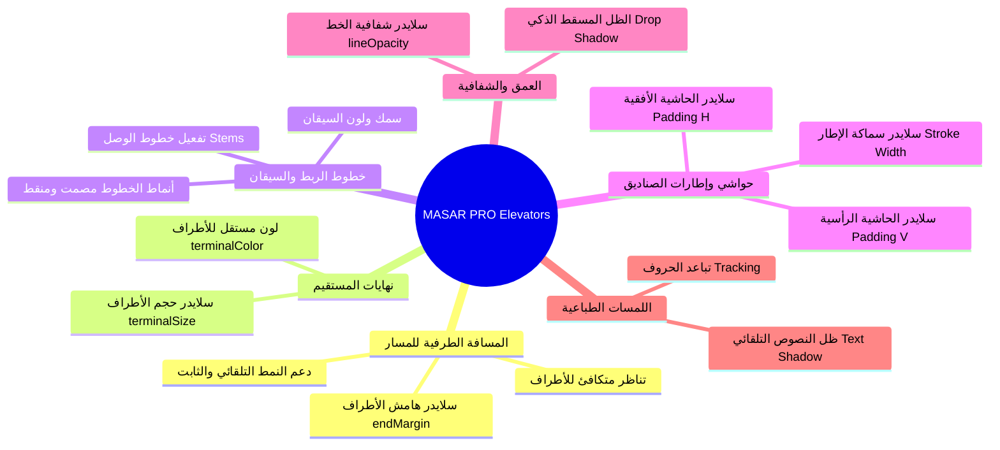

# 🎨 خطة الترقية الجمالية والهندسية لنظام MASAR PRO
> **Aesthetic & Structural Elevation Plan — Broadcast-Grade Precision**  
> *خطة التنفيذ التفصيلية للخصائص الجمالية المتقدمة ومتحكمات المسافات الطرفية*  
> *التاريخ: 24 نوفمبر 2026*

---

## 📌 1. ملخص الرؤية والمطلب الأساسي

بناءً على التحليل المعمق واستناداً إلى الرسم التوضيحي المعتمد، تهدف هذه الخطة إلى إضافة مجموعة من **المتحكمات الجمالية والهندسية عالية القيمة** التي تنقل مشاريع **MASAR PRO** إلى مصاف الأعمال التلفزيونية والسينمائية العالمية، مع التركيز المباشر على **التحكم بالمسافة الحرة بين آخر محطات العقد ونهاية المستقيم**:


---

## 📐 2. التحليل الهندسي للمسافة الطرفية (Baseline End Margin)

### المعضلة الحالية في الكود:
في محرك `bootstrap.jsx` (السطر 843):
```javascript
var margin = 60; // ⚠️ قيمة ثابتة مجمدة برمجياً لا يمكن للمستخدم تعديلها
```
* حالياً، المسافة بين العقدة الأولى وبداية المستقيم، وبين العقدة الأخيرة ونهاية المستقيم محصورة دائماً في `60px`.
* إذا رغب المستخدم في تقريب العقد من السهم/النقطة، أو إعطاء امتداد انسيابي طويل للخط قبل أن ينتهي بطرف السهم، لا يملك أي وسيلة لفعل ذلك من الواجهة.

### الحل الهندسي المعتمد في الخطة:
إلغاء القيمة الثابتة واستبدالها بمتغير حالة تفاعلي:
$$\text{End Margin} \in [0, 400]\text{ px} \quad (\text{Default: } 60\text{px})$$

المعادلة الرياضية لتوزيع العقد بعد الترقية:
$$\text{usableSpan} = \text{length} - 2 \times \text{endMargin}$$
$$\text{step} = \frac{\text{usableSpan}}{N - 1} \quad (N > 1)$$
$$\text{posAlong}(i) = -\frac{\text{length}}{2} + \text{endMargin} + i \times \text{step}$$

> [!TIP]
> تتيح هذه الميزة للمصمم حرية كاملة: جعل العقد تبدأ مباشرة عند أطراف الخط ($\text{endMargin} = 0$)، أو ترك مسافة تنفسية شاسعة ($\text{endMargin} = 150\text{px}$) تعطي إحساساً بالامتداد اللانهائي.

---

## 🎛️ 3. حزمة الإضافات الجمالية والاحترافية المعتمدة (The 6 Features)



### 1️⃣ التحكم بمسافة أطراف المستقيم (End Margin / Terminal Clearance):
- **المتحكم:** سلايدر رقمي `endMargin` بمجال من `0` إلى `350 px` (الافتراضي: `60 px`).
- **الموقع في اللوحة:** التبويب 2 ← القسم 1 (المسار والخط الزمني) بجانب سلايدر طول المسار.
- **التأثير في After Effects:** تحكم لحظي في المسافة بين العقدتين الطرفيتين ونهايتي الخط وشكلي الأطراف (`StartTerminal` و `EndTerminal`).

### 2️⃣ أبعاد ولون نهايات المستقيم المستقلة (Terminal Precision):
- **المتحكم:**
  - سلايدر **حجم الأطراف** `terminalSize` (من `6` إلى `50 px`، الافتراضي مشتق تلقائياً `lineWidth * 3`).
  - مربع لون منبثق **لون الأطراف المستقل** `terminalColor` مع خيار "مطابقة لون الخط".
- **الفائدة الجمالية:** إمكانية تصميم خط أبيض رفيع ينتهي بسهم زمردي عريض بارز يلفت الانتباه.

### 3️⃣ خطوط الربط والسيقان المتصلة (Connector Stems / Leader Lines):
- **المتحكم:** مفتاح تبديل `connectorsEnabled` (تشغيل / إيقاف) + نمط الخط (`solid` / `dotted`).
- **التأثير في After Effects:** عند زيادة مسافة الخلوص (`Top Offset` أو `Bottom Offset`)، يتم رسم خط فيكتور دقيق يمتد من العقدة إلى الصندوق النصي لربطه بصرياً ومنع طفوه في الفراغ.

### 4️⃣ إبراز حواشي وإطارات الصناديق التكيفية (Box Padding & Stroke Control):
- **المتحكمات في التبويب 2 (القسم 4):**
  - سلايدر **الحاشية الأفقية** `boxPaddingH` (من `4` إلى `40 px`).
  - سلايدر **الحاشية الرأسية** `boxPaddingV` (من `2` إلى `30 px`).
  - سلايدر **سماكة إطار الصندوق** `boxStrokeWidth` (من `0` إلى `8 px`).
- **الفائدة الجمالية:** تمكين المستخدم من ضبط راحة البطاقات النصية وصنع تصاميم زجاجية خفيفة بدون إطار أو تصاميم تقنية ذات حواف حادة وواضحة.

### 5️⃣ شفافية الخط والظل المسقط (Line Opacity & Depth Elevation):
- **المتحكمات:**
  - سلايدر **شفافية المستقيم** `lineOpacity` (من `10%` إلى `100%`).
  - مفتاح تفعيل **الظل المسقط (Drop Shadow)** للصناديق والعقد لإنشاء عمق وفصل بصري حقيقي فوق لقطات الفيديو.

### 6️⃣ اللمسات الطباعية المتقدمة (Typography Polish):
- **المتحكمات:** سلايدر **تباعد الحروف (Tracking)** لعناوين المحطات لحمل طابع العلامات التجارية الفاخرة.

---

## 🛠️ 4. خطة التنفيذ البرمجي على 3 مراحل (Execution Roadmap)

### 🚀 المرحلة الأولى: مسافة الأطراف + حواشي الصناديق وأبعاد النهايات (Quick & High-Impact)
1. **تحديث كائن الحالة `state-store.js`:**
   - إضافة `endMargin: 60`.
   - إضافة `terminalSize: 14` و `terminalColor: ''` (فارغ يعني يتبع لون الخط).
   - إضافة `lineOpacity: 100`.
   - إبراز `boxPaddingH`, `boxPaddingV`, `boxStrokeWidth`.
2. **تحديث واجهة المستخدم `index.html` و `flat-spectrum.css`:**
   - إضافة صف سلايدر "هامش أطراف المسار" في القسم الأول مع أيقونة المسافة المتعامدة.
   - إضافة سلايدر حجم ولون النهايات بجانب منتقيات الأسهم.
   - إضافة سلايدرات الحواشي في قسم الصناديق.
3. **تحديث محرك After Effects `bootstrap.jsx`:**
   - استبدال `var margin = 60` بالمعامل الديناميكي `cfg.endMargin`.
   - دعم `terminalSize` و `terminalColor` داخل دالة `addShapeTerminal`.

---

### 🌟 المرحلة الثانية: خطوط الربط الموجهة (Connector Stems Engine)
1. **برمجة دالة رسم السيقان في `bootstrap.jsx`:**
   - إنشاء مسار فيكتور في طبقة `MS_Baseline` أو طبقة مستقلة يمتد من `[posAlong, 0]` إلى موضع الصندوق.
2. **ربط السيقان بالحركة المتتابعة:**
   - ضمان استجابة السيقان آلياً لأي حركة أو إزاحة في الصندوق.

---

### 💎 المرحلة الثالثة: العمق البصري والتأثيرات السينمائية (Shadows & Elevation)
1. **إضافة تأثيرات `Drop Shadow` في After Effects:**
   - تفعيل خيار إضافة `ADBE Drop Shadow` على طبقات الصناديق والعقد عند اختياره.
2. **ضبط تباعد الحروف (Tracking) في كتل النصوص.**

---

## 🛡️ 5. ضمانات عدم التعارض (Zero-Regression Principles)
- **التوافق العكسي 100%:** إذا لم يتم تحديد `endMargin` في القوالب القديمة، تفترض الأداة تلقائياً القيمة `60px`، فلن يتغير شكل أي كومبوزيشن حالي تم تصميمه سابقاً.
- **الحفاظ على الثوابت:** تبقى أسماء الطبقات العشر والعقد البرمجي للطبقات كما هي تماماً.

---

### 💬 قرار البدء:
الخطة الآن مكتملة وتجيب بشكل قاطع على رسمتك وملاحظتك الدقيقة.  
**هل نعتمد الخطة ونبدأ في تنفيذ المرحلة الأولى فوراً؟**
