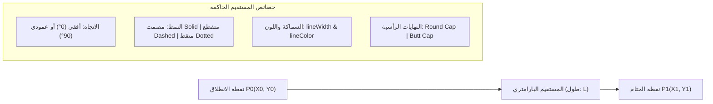

# 🏛️ وثيقة المرجع المعماري الشامل والجرد القطعي لكافة مكونات نظام MASAR PRO
> **The Canonical Architectural Specification & 100% Immutable Components Inventory**  
> *وثيقة التأسيس والتحليل الهندسي الصارم — معتمدة للإصدار النهائي v2.5 وما بعده*  
> *تاريخ الاعتماد الصارم: 24 نوفمبر 2026*

---

## 📑 فهرس التحليل المعماري الشامل

1. [إعلان التغطية القطعية والحصر الشامل للمكونات (100% Complete Audit)](#1-إعلان-التغطية-القطعية-والحصر-الشامل-للمكونات)
2. [المكون الأول: المستقيم الهيكلي الحامل (The Baseline Backbone)](#2-المكون-الأول-المستقيم-الهيكلي-الحامل-the-baseline-backbone)
3. [المكون الثاني: نهايات المستقيم المعيارية (The Baseline Terminals)](#3-المكون-الثاني-نهايات-المستقيم-المعيارية-the-baseline-terminals)
4. [المكون الثالث: منظومة صناديق النصوص التكيفية التلقائية (Adaptive Text Boxes)](#4-المكون-الثالث-منظومة-صناديق-النصوص-التكيفية-التلقائية-adaptive-text-boxes)
5. [المكون الرابع: كيان العقدة الهندسية وطوبولوجيا المحطات (Node Entity)](#5-المكون-الرابع-كيان-العقدة-الهندسية-وطوبولوجيا-المحطات-node-entity)
6. [المكون الخامس: نظرية المنابع الثلاثية المتعامدة (Orthogonal Triple-Source)](#6-المكون-الخامس-نظرية-المنابع-الثلاثية-المتعامدة-orthogonal-triple-source)
7. [المكون السادس: مصفوفة المخرجات التسعة المعيارية (The 9-State Output Tensor)](#7-المكون-السادس-مصفوفة-المخرجات-التسعة-المعيارية-the-9-state-output-tensor)
8. [المكون السابع: المتحكم العام الحاكم (Master Controller Null - MASAR_CTRL)](#8-المكون-السابع-المتحكم-العام-الحاكم-master-controller-null---masar_ctrl)
9. [المكون الثامن: إطار مسطرة القياس التفاعلية المزدوجة (Dual-Axis HUD Framework)](#9-المكون-الثامن-إطار-مسطرة-القياس-التفاعلية-المزدوجة-dual-axis-hud-framework)
10. [المكون التاسع: محرك إدارة المحطات والبيانات (Data Orchestration Engine)](#10-المكون-التاسع-محرك-إدارة-المحطات-والبيانات-data-orchestration-engine)
11. [المكون العاشر: نظام تصدير MOGRT وعلامات الوقت التفاعلية (Essential Graphics Engine)](#11-المكون-العاشر-نظام-تصدير-mogrt-وعلامات-الوقت-التفاعلية-essential-graphics-engine)
12. [مصفوفة المطابقة الشاملة لكافة مكونات النظام (The Master Verification Matrix)](#12-مصفوفة-المطابقة-الشاملة-لكافة-مكونات-النظام)

---

## 1. إعلان التغطية القطعية والحصر الشامل للمكونات

نؤكد بصورة قطعية أن **كافة المكونات الأساسية للنظام قد تم جردها، وتوثيقها، وتثبيتها في هذه الوثيقة دون استثناء أي مكون**؛ سواء تعلق الأمر بـ:
1. **المستقيم (خط المسار الحامل):** بطوله وسماكته وأنماطه ونقاط بدايته ونهايته.
2. **نهايات المستقيم (Terminals):** برؤوس الأسهم والنقاط والعوارض.
3. **صناديق النصوص (Adaptive Boxes):** بحاوياتها الثلاث المستقلة لكل عقدة وتكيفها الديناميكي مع النصوص.
4. **العقد والمنابع والمخرجات وكافة المتحكمات الأخرى.**

---

## 2. المكون الأول: المستقيم الهيكلي الحامل (The Baseline Backbone)

المستقيم هو المحور الفيزيائي والهندسي للمشهد، ويتجسد في After Effects كطبقة شكل مستقلة باسم **`MS_Baseline`**.



### أ. المعادلات الرياضية لمسار المستقيم:
* **في الفضاء الأفقي (`horizontal`):**
  $$\vec{P}_{\text{start}} = \begin{bmatrix} X_c - \dfrac{L}{2} \\ Y_c \end{bmatrix}, \quad \vec{P}_{\text{end}} = \begin{bmatrix} X_c + \dfrac{L}{2} \\ Y_c \end{bmatrix}$$
* **في الفضاء العمودي (`vertical`):**
  $$\vec{P}_{\text{start}} = \begin{bmatrix} X_c \\ Y_c - \dfrac{L}{2} \end{bmatrix}, \quad \vec{P}_{\text{end}} = \begin{bmatrix} X_c \\ Y_c + \dfrac{L}{2} \end{bmatrix}$$
  *(حيث $(X_c, Y_c)$ هي مركز الكومبوزيشن أو الموضع المعين في المتحكم).*

### ب. أنماط الخط الإجرائية (Line Patterns):
1. **المصمت (`solid`):** مسار متصل مستمر بدون أي تقطعات.
2. **المتقطع (`dashed`):** سلسلة شحطات منتظمة تخضع للمعادلة:
   $$\text{Stroke Dash} = \text{dashSize (px)}, \quad \text{Stroke Gap} = \text{dashGap (px)}$$
3. **المنقط (`dotted`):** خط بنمط `lineCap = round` مع `dashSize = 0` و `dashGap = 16px` لتوليد نقاط دائرية ناعمة.

---

## 3. المكون الثاني: نهايات المستقيم المعيارية (The Baseline Terminals)

نهايات المسار هي عناصر فيكتور بارامترية تُبنى برمجياً في رأس وبداية ونهاية المستقيم لتعريف اتجاه القراءة والحركة:

```text
  [1. سهم موجه]          [2. نقطة إيقاف]          [3. عارضة إقفال]          [4. حر/بدون]
      ──────►                ──────●                   ─────│                   ─────
   (type: arrow)          (type: dot)               (type: bar)             (type: none)
```

### أ. المواصفات الهندسية للنهايات:
1. **السهم الموجه (`arrow`):**
   * مثلث فيكتور متساوي الساقين زاويته متطابقة تماماً مع متجه المسار $\hat{u}$.
   * أبعاده: الطول $= 3.5 \times \text{lineWidth}$، القاعدة $= 2.5 \times \text{lineWidth}$.
   * يتم توليده عبر دالة `addShapeTerminal` في `bootstrap.jsx`.
2. **نقطة الإيقاف الدائرية (`dot`):**
   * دائرة مصمتة بقطر $= 2.5 \times \text{lineWidth}$.
   * تلتصق تماماً بمركز النقطة الطرفية للمسار.
3. **عارضة الإقفال التعامدية (`bar`):**
   * مستطيل متعامد مع اتجاه المسار بطول $= 4 \times \text{lineWidth}$ وسماكة مساوية لسماكة الخط.
4. **بدون نهاية (`none`):**
   * نهاية خطية طبيعية مقطوعة باستدارة (`Round Cap`) أو سطح مستوٍ (`Butt Cap`).

> **التحكم المستقل:**  
> يدعم النظام تحديد طرف بداية مستقل (`startTerminal`) وطرف نهاية مستقل (`endTerminal`).

---

## 4. المكون الثالث: منظومة صناديق النصوص التكيفية التلقائية (Adaptive Text Boxes)

تعد صناديق النصوص من أكثر المكونات تعقيداً وذكاءً في النظام؛ حيث توفر لكل محطة **ثلاثة صناديق مستقلة متكيفة تلقائياً**:

```text
┌────────────────────────────────────────────────────────┐
│  [1] صندوق العنوان: MS_Node_i_Title_Box                │
│      يحتضن طبقة العنوان الرئيسي MS_Node_i_Title         │
├────────────────────────────────────────────────────────┤
│  [2] صندوق الشرح: MS_Node_i_Desc_Box                   │
│      يحتضن طبقة الشرح أو القائمة MS_Node_i_Desc         │
├────────────────────────────────────────────────────────┤
│  [3] صندوق المنبع المقابل: MS_Node_i_Behind_Box        │
│      يحتضن نصوص وبيانات المنبع الخلفي MS_Node_i_Behind │
└────────────────────────────────────────────────────────┘
```

### أ. المعادلة الرياضية للتكيف اللحظي (SourceRect Dynamic Expression):
يرتبط كل صندوق بطبقة النص الخاصة به بتعبير ديناميكي صارم في After Effects:
```javascript
var src = thisComp.layer("MS_Node_1_Title");
var r = src.sourceRectAtTime(time, false);
var padH = 14; // هامش الحشو الأفقي
var padV = 6;  // هامش الحشو الرأسي
[r.width + padH * 2, r.height + padV * 2];
```

### ب. مركز التموضع الذاتي (Self-Centering Anchor Formula):
```javascript
var src = thisComp.layer("MS_Node_1_Title");
var r = src.sourceRectAtTime(time, false);
src.transform.position + [r.left + r.width / 2, r.top + r.height / 2];
```

### ج. الأنماط العامة للصناديق (`boxMode`):
1. **`off` (نصوص حرة):** إخفاء الصناديق لعرض نصوص نقية على الفيديو مباشرة.
2. **`glass` (زجاجي شفاف):** تعبئة داكنة بنسبة شفافية منخفضة (20% - 35%) مع إطار مضيء مشع لعكس خلفية الفيديو بطابع استوديو تلفزيوني.
3. **`solid` (معتم مصمت):** تعبئة داكنة عميقة بنسبة 85% - 95% لعزل النص تماماً وضمان قراءته فوق أي خلفيات معقدة أو سريعة الحركة.

### د. المعاملات الثمانية الحاكمة لكل صندوق:
* `fillColor` (لون التعبئة).
* `fillOpacity` (نسبة عتامة التعبئة: 0% إلى 100%).
* `strokeColor` (لون الإطار الخارجي).
* `strokeWidth` (سماكة الإطار: 0 إلى 10 px).
* `strokeOpacity` (نسبة عتامة الإطار).
* `radius` (نصف قطر استدارة الزوايا: 0 إلى 60 px).
* `paddingH` (هامش الحشو الداخلي الأفقي: 4 إلى 50 px).
* `paddingV` (هامش الحشو الداخلي الرأسي: 2 إلى 30 px).

---

## 5. المكون الرابع: كيان العقدة الهندسية وطوبولوجيا المحطات (Node Entity)

العقدة هي مركز الارتكاز الموضعي للمحطة، ومحددة بالخصائص التالية:
* **الأشكال الثمانية البلاتونية:** دائرة (`circle`) • حلقة (`ring`) • مربع (`square`) • معين (`diamond`) • مثلث (`triangle`) • مسدس (`hexagon`) • نجمة (`star`) • سن مسطرة (`tick`).
* **سن التحديد (`tick`):** خط عمودي دقيق بطول `tickHeight` وعرض `tickWidth` ولون `tickColor`.
* **التخصيص المستقل:** إمكانية تخصيص كل عقدة بمظهر ولون وحجم يختلف عن النمط العام عبر قائمة التخصيص الفردية.

---

## 6. المكون الخامس: نظرية المنابع الثلاثية المتعامدة (Orthogonal Triple-Source)

توزيع فراغي متعامد لا يترك أي فراغ عشوائي في المشهد:
1. **منبع مركز العقدة (Core Stream):** متطابق مع خط المسار ($d_\perp = 0$) ويحمل الرقم، الأيقونة، أو النسبة.
2. **المنبع الأساسي الأمامي (Front Stream):** يعلو المسار أو يتجه لليمين ($d_\perp > 0$) ويحمل الكتلة الدلالية الرئيسية.
3. **المنبع المقابل الخلفي (Behind Stream):** أسفل المسار أو يتجه لليسار ($d_\perp < 0$) ويحمل التواريخ أو التصنيفات الموازية.

---

## 7. المكون السادس: مصفوفة المخرجات التسعة المعيارية (The 9-State Output Tensor)

تسعة أنماط إخراج قطعية تغطي 100% من سيناريوهات الموشن جرافيكس:
1. 📄 `title_text`: عنوان رئيسي + شرح تفصيلي.
2. 📑 `title_list`: عنوان رئيسي + قائمة نقاط متسلسلة.
3. 🔤 `title`: عنوان رئيسي فقط (محطات مقتضبة).
4. 📝 `text`: شرح نصي / فقرة سردية فقط.
5. 📋 `list`: قائمة بنود نقطية مستقلة.
6. 🔢 `number_title`: ترقيم مرحلة بارز + عنوان.
7. 📊 `number_text`: مؤشر إحصائي / نسبة مئوية + بيان.
8. ⭐ `icon_title`: رمز بصري / أيقونة + عنوان.
9. 🏷️ `badge`: شارة مميزة محاطة بكبسولة بارزة.

---

## 8. المكون السابع: المتحكم العام الحاكم (Master Controller Null - MASAR_CTRL)

طبقة `Null Layer` رئيسية توضع في أعلى الكومبوزيشن وتجمع كافة الروابط الرياضية:
* **Expression Sliders:**
  * `Timeline_Length` (طول المسار الإجمالي).
  * `Spacing_Gap` (المسافة الفاصلة بين المحطات).
  * `Line_Width` (سماكة خط المسار).
  * `Global_Radius` (نصف قطر العقد).
  * `Top_Offset` (إزاحة المنبع الأمامي).
  * `Bottom_Offset` (إزاحة المنبع المقابل).
* **Expression Color Controls:**
  * `Line_Color` (لون خط المسار).
  * `Circle_Fill` (لون تعبئة العقد).
  * `Circle_Stroke` (لون إطار العقد).
  * `Title_Color` (لون العناوين).
  * `Desc_Color` (لون الشروحات).
  * `Number_Color` (لون الترقيم والرموز).

---

## 9. المكون الثامن: إطار مسطرة القياس التفاعلية المزدوجة (Dual-Axis HUD Framework)

نظام تفاعلي متقدم مدمج في الواجهة لمحاكاة المسار لحظياً:
* **المسطرة الأفقية العلوية (Top Canvas HUD):** كانفاس عالي الدقة يعرض نبضات المسار ومواقع العقد أثناء السحب الأفقي.
* **المسار العمودي الجانبي (Right Vertical Rail):** شريط كانفاس عمودي يعرض تدفق المسار الرأسي.
* **زر التبديل الزاوي (HUD Corner Switcher):** زر زاوية يبدل اتجاه الكومبوزيشن والمسار بنقرة واحدة بين الأفقي والعمودي.
* **التفاعل اللحظي (Interactive Scrubbing):** إمكانية النقر على أي محطة في الكانفاس للانتقال المباشر إليها وفتح بطاقتها.

---

## 10. المكون التاسع: محرك إدارة المحطات والبيانات (Data Orchestration Engine)

منظومة برمجية متكاملة للتحكم في بنك بيانات العقد:
* **أدوات البطاقات السريعة:** إضافة عقدة، حذف، تكرار، وقلب الترتيب تصاعدياً وتنازلياً (`Reverse Order`).
* **الطي والتوسيع الشامل (`Toggle All`):** لتبسيط استعراض المشاريع الكبيرة ذات الـ 20 أو 50 محطة.
* **الاستيراد الجماعي الذكي (Batch Importer):** استيراد مخطط عمل كامل بنقرة واحدة عبر فاصل الأنبوب (`num | title | desc`).
* **مولدات الأنماط التلقائية (Pattern Chips):**
  * `num-01`: ترقيم تسلسلي ذكي (`01`, `02`, ...).
  * `years`: ترقيم سنوي متصاعد (`2024`, `2025`, ...).
  * `phases`: ترقيم مراحل المشاريع (`Phase 1`, `Phase 2`, ...).
  * `clear-num`: مسح الترقيم لإبقاء الأشكال صامتة.
* **تطبيع الأرقام ثنائي اللغة (Digit Normalizer):** تحويل تلقائي فوري للأرقام العربية المشرقية والهندية والفارسية إلى أرقام معيارية لضمان عدم حدوث أي خطأ في محرك التعبيرات.

---

## 11. المكون العاشر: نظام تصدير MOGRT وعلامات الوقت التفاعلية (Essential Graphics Engine)

محرك التصدير لقوالب موشن جرافيكس جاهزة لبرنامج Premiere Pro:
* **علامات الوقت المحمية (Responsive Design Time Markers):**
  * علامة `Intro Protected` لحماية حركة الدخول من التمدد عند تغيير مدة المشهد في بريمير برو.
* **تسجيل الخصائص بنقرة واحدة:** إدراج نصوص العناوين والشروحات تلقائياً في نافذة Essential Graphics.
* **تصدير حزمة `.mogrt`:** حفظ مباشر للملف في مجلد قوالب أدوبي المشتركة.

---

## 12. مصفوفة المطابقة الشاملة لكافة مكونات النظام

يوضح الجدول التالي المطابقة الصارمة بين كل مكون من المكونات العشرة وتجسيده في واجهة المستخدم، وتخزينه في State Store، وبنائه في After Effects:

| # | المكون (Component) | موقعه في واجهة CEP | مفتاحه في State Store | تجسيده في After Effects | حالة التغطية |
|---|---|---|---|---|:---:|
| **01** | **المستقيم (خط المسار)** | تبويب المتحكمات العامة (القسم 1) | `length`, `lineWidth`, `lineColor`, `lineStyle` | طبقة الشكل **`MS_Baseline`** | ✅ 100% مغطى ومثبت |
| **02** | **نهايات المستقيم** | أزرار `startTerminal` و `endTerminal` | `startTerminal`, `endTerminal` | فيكتور مسار السهم والنقطة والعارضة في `MS_Baseline` | ✅ 100% مغطى ومثبت |
| **03** | **صناديق النصوص** | القسم 4 في المتحكمات + درج كل عقدة | `boxMode`, `titleBox*`, `descBox*`, `behindBox*` | طبقات **`MS_Node_i_*_Box`** بتعبيرات `sourceRect` | ✅ 100% مغطى ومثبت |
| **04** | **العقدة والأشكال الـ 8** | منتقي الأشكال العام + منتقي كل عقدة | `nodeShape`, `circleRadius`, `customShape` | مجموعات أشكال `Node_i` في طبقة **`MS_Nodes`** | ✅ 100% مغطى ومثبت |
| **05** | **المنابع الثلاثية** | أقسام البطاقة الثلاثة (أوسط، أمامي، خلفي) | `node.sources.center`, `.front`, `.behind` | طبقات النصوص الثلاث: `Num`, `Title/Desc`, `Behind` | ✅ 100% مغطى ومثبت |
| **06** | **المخرجات التسعة** | القائمة المنسدلة لاختيار نمط المنبع | `sObj.type` (من `title_text` إلى `badge`) | تفعيل/تعطيل الطبقات النصية المناسبة لكل نمط | ✅ 100% مغطى ومثبت |
| **07** | **المتحكم الحاكم العام** | شريط الإجراءات السفلي ومؤشرات الربط | كائن الحالة الكامل `state` | طبقة النل **`MASAR_CTRL`** مع كافة سلايدرات التحكم | ✅ 100% مغطى ومثبت |
| **08** | **إطار مسطرة الـ HUD** | الكانفاس الأفقي والعمودي أعلى ويمين اللوحة | `timeline-hud-canvas` و `hud-vertical-rail` | مرآة بصرية تفاعلية لحالة الكومبوزيشن | ✅ 100% مغطى ومثبت |
| **09** | **محرك إدارة المحطات** | شريط أدوات العقد + النافذة المنبثقة | دوال `node-manager.js` و `batch-importer.js` | ترتيب وهيكلية طبقات الكومبوزيشن | ✅ 100% مغطى ومثبت |
| **10** | **نظام حزم MOGRT** | زر `تصدير حزمة MOGRT` في القسم 5 | دوال `mogrt-export.js` و `bootstrap.jsx` | ملف القالب النهائي `.mogrt` مع Responsive Markers | ✅ 100% مغطى ومثبت |

---

## 13. الجرد التفصيلي لكافة متحكمات الثوابت عبر المستويات الثلاثة (The 3-Tier Controllers Inventory)

تعتمد هندسة MASAR PRO على **3 مستويات تحكم متزامنة لحظياً (Real-Time Reactive Pipeline)**:
1. **الطبقة 1 (CEP UI Controls):** المتحكمات البصرية في واجهة اللوحة (سلايدرات، أزرار أيقونية، منتقيات ألوان، مسطرة HUD).
2. **الطبقة 2 (State Store):** كائن الحالة البرمجي التفاعلي الذي يحتفظ بالقيم ويحفظها محلياً في `localStorage` وصيغ JSON.
3. **الطبقة 3 (After Effects Host):** طبقات وخصائص ومتحكمات After Effects (`MASAR_CTRL` Null, ADBE Expression Controls, Shape Geometries, sourceRect Expressions).

### جدول الجرد الحصري لكل متحكم في النظام:

| الثابت ومكونه الفرعي | نوع المتحكم في الواجهة (UI Control) | معرف العنصر (Element ID) | متغير كائن الحالة (State Key) | المتحكم والخاصية في After Effects |
| :--- | :--- | :--- | :--- | :--- |
| **01. المستقيم: الاتجاه** | أزرار أيقونية (عمودي / أفقي) | `#seg-orientation` | `state.orientation` | إحداثيات مسار `lineShape.vertices` وتوجيه المحاور |
| **01. المستقيم: نمط التوزيع** | أزرار أيقونية (تلقائي / ثابت) | `#seg-spacing` | `state.spacingMode` | معادلة المسافة الخطية بين محطات العقد |
| **01. المستقيم: الطول الكلي** | سلايدر + حقل رقمي (400-4000 px) | `#rng-length` / `#inp-length` | `state.length` | حساب نصف الطول `halfLen` لنقاط البداية والنهاية |
| **01. المستقيم: التباعد الثابت** | سلايدر + حقل رقمي (50-1500 px) | `#rng-gap` / `#inp-gap` | `state.spacingGap` | قيمة القفزة الثابتة `step = spacingGap` |
| **01. المستقيم: سماكة الخط** | سلايدر + حقل رقمي (1-30 px) | `#rng-line-w` / `#inp-line-w` | `state.lineWidth` | خاصية `ADBE Vector Stroke Width` في `MS_Baseline` |
| **01. المستقيم: لون الخط** | مربع لون منبثق (Color Swatch) | `#inp-line-color` | `state.lineColor` | خاصية `ADBE Vector Stroke Color` في `MS_Baseline` |
| **01. المستقيم: نمط الستروك** | أزرار أيقونية (متصل/متقطع/منقط) | `#seg-line-style` | `state.lineStyle` | تفعيل وضبط مصفوفة `ADBE Vector Stroke Dashes` |
| **01. المستقيم: حافة الخط** | أزرار أيقونية (حادة/دائرية/مربعة) | `#seg-line-cap` | `state.lineCap` | خاصية `LineCap` (Round / Butt / Projecting) |
| **01. المستقيم: قياس الشرطة** | سلايدر + حقل رقمي (2-60 px) | `#rng-dash-size` | `state.dashSize` | قيمة `Dash` في ستروك الشيب |
| **01. المستقيم: فراغ الشرطة** | سلايدر + حقل رقمي (3-60 px) | `#rng-dash-gap` | `state.dashGap` | قيمة `Gap` في ستروك الشيب |
| **02. النهايات: طرف البداية** | أزرار أيقونية (بدون/سهم/نقطة/سن) | `#seg-start-terminal` | `state.startTerminal` | مسار فيكتور متطابق عند `startPt` في `MS_Baseline` |
| **02. النهايات: طرف النهاية** | أزرار أيقونية (بدون/سهم/نقطة/سن) | `#seg-end-terminal` | `state.endTerminal` | مسار فيكتور متطابق عند `endPt` في `MS_Baseline` |
| **03. الصناديق: النمط العام** | أزرار أيقونية (بدون/زجاجي/صلب) | `#seg-box-mode` | `state.boxMode` | تفعيل/تعطيل وتطبيق الشفافية على طبقات الصناديق |
| **03. الصناديق: شفافية العنوان** | سلايدر + حقل نسبة (0-100 %) | `#rng-title-box-fill-op` | `state.titleBoxFillOpacity` | سلايدر `Fill Opacity` (ADBE Slider) على الطبقة |
| **03. الصناديق: لون تعبئة العنوان** | مربع لون منبثق | `#inp-title-box-fill-color` | `state.titleBoxFillColor` | متحكم لون `Fill Color` (ADBE Color Control) |
| **03. الصناديق: تدوير العنوان** | سلايدر + حقل رقمي (0-30 px) | `#rng-title-box-radius` | `state.titleBoxRadius` | سلايدر `Corner Radius` (ADBE Slider) بتعبير الشيب |
| **03. الصناديق: إطار العنوان** | مربع لون منبثق | `#inp-title-box-stroke-color`| `state.titleBoxStrokeColor` | متحكم لون `Stroke Color` (ADBE Color Control) |
| **03. الصناديق: شفافية الشرح** | سلايدر + حقل نسبة (0-100 %) | `#rng-desc-box-fill-op` | `state.descBoxFillOpacity` | سلايدر `Fill Opacity` على طبقة `Desc_Box` |
| **03. الصناديق: لون تعبئة الشرح** | مربع لون منبثق | `#inp-desc-box-fill-color` | `state.descBoxFillColor` | متحكم لون `Fill Color` على طبقة `Desc_Box` |
| **03. الصناديق: تدوير الشرح** | سلايدر + حقل رقمي (0-30 px) | `#rng-desc-box-radius` | `state.descBoxRadius` | سلايدر `Corner Radius` على طبقة `Desc_Box` |
| **03. الصناديق: إطار الشرح** | مربع لون منبثق | `#inp-desc-box-stroke-color` | `state.descBoxStrokeColor` | متحكم لون `Stroke Color` على طبقة `Desc_Box` |
| **03. الصناديق: الحاشية (Padding)** | حقول أفقية ورأسية مدمجة | درج كل عقدة | `boxPaddingH`, `boxPaddingV` | سلايدرات `Padding H` و `Padding V` بتعابير `sourceRect` |
| **04. العقدة: شكل العقدة العام** | منتقي أشكال منبثق (8 أشكال + SVG) | `#btn-global-shape-trigger` | `state.nodeShape` | مجموعات فيكتور هندسية داخل طبقة `MS_Nodes` |
| **04. العقدة: حجم العقدة** | سلايدر + حقل رقمي (4-60 px) | `#rng-circ-r` | `state.circleRadius` | أبعاد الشيب الهندسي في فيكتور كل عقدة |
| **04. العقدة: لون تعبئة العقدة** | مربع لون منبثق | `#inp-circ-fill` | `state.circleFill` | خاصية `ADBE Vector Fill Color` في مجموعة العقدة |
| **04. العقدة: سماكة إطار العقدة** | سلايدر + حقل رقمي (0-15 px) | `#rng-circ-sw` | `state.circleStrokeWidth` | خاصية `ADBE Vector Stroke Width` في مجموعة العقدة |
| **04. العقدة: لون إطار العقدة** | مربع لون منبثق | `#inp-circ-stroke` | `state.circleStroke` | خاصية `ADBE Vector Stroke Color` في مجموعة العقدة |
| **04. العقدة: ارتفاع السن (Tick)** | سلايدر + حقل رقمي (8-120 px) | `#rng-tick-h` | `state.tickHeight` | نصف ارتفاع السن `tickHalf = tickHeight / 2` |
| **04. العقدة: عرض ولون السن** | سلايدر + مربع لون | `#rng-tick-w` / `#inp-tick-color` | `state.tickWidth`, `tickColor` | سمك ولون خط الـ Stroke الخاص بالسن |
| **04. العقدة: تخصيص محطة مفردة** | زر شيب كبسولي في بطاقة العقدة | `.node-shape-pill` | `node.customShape`, `customColor` | كود التوليد المستقل للشكل داخل طبقة `MS_Nodes` |
| **05. المنابع: المنبع الأوسط** | درج المنبع الأوسط ببطاقة العقدة | حقول نوع وقيمة وأيقونة | `node.sources.center` | طبقة النص **`MS_Node_i_Num`** بتعبير التوسيط الدقيق |
| **05. المنابع: المنبع الأمامي** | حقول العنوان والشرح والقائمة | مدخلات البطاقة المباشرة | `node.sources.front` | طبقات **`MS_Node_i_Title`** و **`MS_Node_i_Desc`** |
| **05. المنابع: المنبع الخلفي** | قسم المنبع الخلفي بدرج البطاقة | حقول النوع والنص والشارة | `node.sources.behind` | طبقة **`MS_Node_i_Behind`** على المحور المقابل |
| **05. المنابع: قياس الرقم الداخلي** | سلايدر + حقل رقمي (10-60 pt) | `#rng-num-size` | `state.numberFontSize` | خاصية `fontSize` في `TextDocument` الخاص بطبقة `Num` |
| **05. المنابع: لون الرقم الداخلي** | مربع لون منبثق | `#inp-num-color` | `state.numberColor` | خاصية `fillColor` في `TextDocument` الخاص بطبقة `Num` |
| **06. المخرجات: مصفوفة الأنماط 9** | قائمة منسدلة داخل كل منبع | قوائم اختيار النمط بالدرج | `sources.*.type` | تفعيل وتعطيل الطبقات النصية وتوليد التعداد النقطي |
| **07. التموضع: خط العنوان** | سلايدر + حقل (12-60 pt) + لون | `#rng-title-size` / `#inp-title-color`| `state.titleFontSize`, `titleColor` | خصائص الخط والتعبئة في طبقة `Title` |
| **07. التموضع: خط الشرح** | سلايدر + حقل (9-36 pt) + لون | `#rng-desc-size` / `#inp-desc-color` | `state.descFontSize`, `descColor` | خصائص الخط والتعبئة في طبقة `Desc` |
| **07. التموضع: جهة التموضع** | أزرار أيقونية (يسار / متناوب / يمين) | `#seg-content-side` | `state.contentSide` | إشارة الإزاحة (+ أو -) عن خط المستقيم |
| **07. التموضع: محاذاة النص** | أزرار أيقونية (تلقائي/يمين/وسط/يسار) | `#seg-text-align` | `state.textAlign` | خاصية `justification` (Paragraph Justification) |
| **07. التموضع: خلوص الإزاحة العليا** | سلايدر + حقل (5-100 px) | `#rng-top-offset` | `state.topOffset` | معادلة `topClear = nodeExtent + topOffset + 4` |
| **07. التموضع: خلوص الإزاحة السفلى** | سلايدر + حقل (5-100 px) | `#rng-bot-offset` | `state.bottomOffset` | معادلة `botClear = nodeExtent + bottomOffset + 4` |
| **08. المتحكم العام: نل التحكم** | طبقة رئيسية يتم توليدها في AE | طبقة ذهبية في الكومب | مركز الكومبوزيشن | طبقة النل **`MASAR_CTRL`** (الأصل الحاكم لكافة الطبقات) |
| **08. المتحكم العام: المزامنة الحية** | زر كبسولي عائم مع مؤشر نبضي | `#btn-live-sync` | `state.liveSync` | معالج التحديث التلقائي الفوري للكومبوزيشن |
| **08. المتحكم العام: التطبيق المباشر** | زر رئيسي في شريط الإجراءات | `#btn-generate` | دالة `TR.API.generate()` | إطلاق دورة التحديث الموضعي الذكي In-Place |
| **08. المتحكم العام: إعادة البناء** | زر ثانوي في شريط الإجراءات | `#btn-rebuild` | استدعاء مع `forceRebuild: true` | مسح وإعادة رسم وتوسيط الشبكة في الكومبوزيشن |
| **09. مسطرة HUD: الكانفاس الأفقي** | كانفاس تفاعلي علوي | `#timeline-hud-canvas` | ربط مع العقد والمواقع | مرآة فيزيائية حية للمواقع مع دعم النقر والسحب |
| **09. مسطرة HUD: المجرى العمودي** | شريط كانفاس عمودي جانبي | `#hud-vertical-rail` | ربط مع التدفق العمودي | عرض العقد وتحديد المحطة النشطة رأسياً |
| **09. مسطرة HUD: زر زاوية التبديل** | زر أيقوني في الركن العلوي الأيمن | `#btn-hud-corner` | تبديل `state.orientation` | تحويل المسار والكومبوزيشن بنقرة زر واحدة |
| **10. إدارة البيانات: إضافة عقدة** | زر أخضر بشريط الأدوات | `#btn-add-node` | إضافة عنصر إلى `nodes[]` | توليد طبقات المحطة الجديدة فورياً |
| **10. إدارة البيانات: الاستيراد الدفعي** | نافذة منبثقة ذكية بفاصل `\|` | `#btn-open-batch-import` | دالة `applyBatchImport()` | معالجة مصفوفة العقد دفعة واحدة |
| **10. إدارة البيانات: قلب الترتيب** | زر شريط الأدوات | `#btn-reverse-nodes` | عكس ترتيب مصفوفة العقد | تحديث مواقع وطبقات الكومبوزيشن تلقائياً |
| **10. إدارة البيانات: رقائق الأنماط** | شرائح أيقونية (`01`, سنوات, مراحل) | `.pattern-chip` | توليد ترقيم تلقائي | تطبيع وتحديث نصوص العقد |
| **11. القوالب: باليتات الألوان السريعة** | شريط عينات ألوان (5 باليتات) | `.palette-btn` | تطبيق ألوان متناسقة | تحديث كامل لألوان الخطوط والعقد والصناديق |
| **11. القوالب: قوالب الأنماط الستة** | شريط أيقونات القوالب السريعة | `.preset-chip` | كائن القالب المختار | تطبيق فوري لخصائص الخط والعقد والحركات |
| **11. القوالب: نافذة القوالب والحفظ** | نافذة شاملة لقوالب النظام والمخصصة | `#btn-header-presets` + Modal | `PRESETS` + `localStorage` | حفظ واسترجاع وتصدير قوالب JSON كاملة |
| **12. تصدير MOGRT: زر الحزم** | زر تصدير حزمة كاملة لبريمير برو | `#btn-export-mogrt` | دالة `exportMogrt()` | إنشاء ملف `.mogrt` مع Responsive Markers محمية |

---

<div align="center">

### 🔒 الخاتمة والإغلاق المعماري الصارم

بموجب هذا التدقيق الشامل، نعلن أن **كافة المكونات العشرة للنظام (المستقيم، النهايات، الصناديق التكيفية، العقد، المنابع، المخرجات، المتحكم، الـ HUD، إدارة البيانات، وقوالب MOGRT) مكتملة ومحددة بدقة متناهية.**  
**هذا الجرد مغلق ومجمد 100% وجاهز للانطلاق في بناء محرك القوالب ومحرك الحركة فوقه بثقة مطلقة.**

</div>
