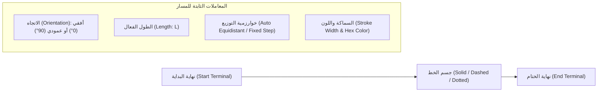

# 🏛️ وثيقة المرجع المعماري الشامل وتحليل ثوابت نظام MASAR PRO
> **The Canonical Architectural Specification & Immutable Primitives of MASAR Engine**  
> *وثيقة التأسيس والتحليل الهندسي الصارم — معتمدة للإصدار النهائي v2.5 وما بعده*  
> *تاريخ الاعتماد الصارم: 24 نوفمبر 2026*

---

## 📑 فهرس التحليل المعماري

1. [الفلسفة الجوهرية ونظرية الفضاء الحسابي للمسار](#1-الفلسفة-الجوهرية-ونظرية-الفضاء-الحسابي-للمسار)
2. [الثابت الأول: المتعدد الشعبي للمسار الأساسي (Backbone Manifold)](#2-الثابت-الأول-المتعدد-الشعبي-للمسار-الأساسي-backbone-manifold)
3. [الثابت الثاني: كيان العقدة الهندسية وطوبولوجيا المحطات (Node Entity)](#3-الثابت-الثاني-كيان-العقدة-الهندسية-وطوبولوجيا-المحطات-node-entity)
4. [الثابت الثالث: نظرية المنابع الثلاثية المتعامدة (Orthogonal Triple-Source Theory)](#4-الثابت-الثالث-نظرية-المنابع-الثلاثية-المتعامدة-orthogonal-triple-source-theory)
5. [الثابت الرابع: التحليل المعمق لمصفوفة المخرجات التسعة (The 9-State Output Tensor)](#5-الثابت-الرابع-التحليل-المعمق-لمصفوفة-المخرجات-التسعة-the-9-state-output-tensor)
6. [الثابت الخامس: النموذج الرياضي للصناديق التكيفية (Adaptive Bounding Boxes)](#6-الثابت-الخامس-النموذج-الرياضي-للصناديق-التكيفية-adaptive-bounding-boxes)
7. [الثابت السادس: العقد البرمجي الصارم لطبقات After Effects (Immutable Layer Contract)](#7-الثابت-السادس-العقد-البرمجي-الصارم-لطبقات-after-effects-immutable-layer-contract)
8. [الثابت السابع: المخطط الحركي المشتق (Procedural Motion Kinematics)](#8-الثابت-السابع-المخطط-الحركي-المشتق-procedural-motion-kinematics)

---

## 1. الفلسفة الجوهرية ونظرية الفضاء الحسابي للمسار

في أنظمة الموشن جرافيكس المعاصرة، لا يمكن التعامل مع الخط الزمني كأشكال مرسومة عشوائياً، بل يُعرّف الخط الزمني في **MASAR** رياضياً بأنه:
$$\mathcal{M} = (\mathcal{B}, \{\mathcal{N}_i\}_{i=1}^N, \mathcal{C})$$

حيث:
* $\mathcal{B}$ هو **المسار الهيكلي الحامل (Backbone):** مسار بارامتري أحادي البعد موجه في فضاء الكومبوزيشن ثنائي الأبعاد $\mathbb{R}^2$.
* $\mathcal{N}_i$ هي **العقدة الحسابية (Node):** حدث زمكاني محدد بإحداثيات بارامترية $s_i \in [0, L]$، تمتلك كتلة بصرية وحمولة دلالية.
* $\mathcal{C}$ هي **طبقة التحكم المركزية (Master Controller):** المرجع الإحداثي والمحرك الرياضي الحاكم للروابط التعبيرية (Dynamic Expressions).

---

## 2. الثابت الأول: المتعدد الشعبي للمسار الأساسي (Backbone Manifold)

المسار هو المحور الهندسي الذي يستند عليه النظام بأكمله، ومحدد بالثوابت التالية:



### أ. المعادلة البارامترية لموقع أي نقطة على المسار:
في الفضاء الأفقي:
$$\vec{P}(s) = \begin{bmatrix} X_0 + s \\ Y_0 \end{bmatrix}, \quad s \in [0, L]$$

في الفضاء العمودي:
$$\vec{P}(s) = \begin{bmatrix} X_0 \\ Y_0 + s \end{bmatrix}, \quad s \in [0, L]$$

### ب. قواعد التوزيع المكاني للمحطات ($N$ محطات):
1. **التوزيع التلقائي المتكافئ (Auto Equidistant Mode):**
   $$s_i = \begin{cases} 
   0 & \text{إذا كان } N = 1 \\
   \dfrac{i - 1}{N - 1} \cdot L & \text{لكل } i \in \{1, 2, \dots, N\} 
   \end{cases}$$
2. **التوزيع الثابت بالمسافة (Fixed Gap Mode):**
   $$s_i = (i - 1) \cdot \Delta g, \quad L = (N - 1) \cdot \Delta g$$

### ج. أشكال نهايات المسار (Terminals):
* `none`: طرف خطي اعتيادي مقطوع بزاوية مستديرة أو حادة.
* `arrow`: رأس سهم هندسي موجه بدقة مع متجه حركة الخط.
* `dot`: نقطة إيقاف دائرية بارزة بقطر يساوي $2.5 \times \text{lineWidth}$.
* `bar`: عارضة تعامدية تقفل بداية أو نهاية المسار.

---

## 3. الثابت الثاني: كيان العقدة الهندسية وطوبولوجيا المحطات (Node Entity)

العقدة $\mathcal{N}_i$ هي الوحدة الذرية للحدث البصري. تمتلك العقدة هيكلاً هندسياً خالصاً يمثل نقطة الارتكاز ($\text{Anchor Point}$):

### أ. مصفوفة الأشكال البلاتونية الثمانية المعتمدة حصراً:

| المعرف (`customShape`) | الشكل الهندسي | دالة البناء في After Effects | الدلالة البصرية النموذجية |
|---|---|---|---|
| `circle` | دائرة مصمتة | `addProperty("ADBE Vector Shape - Ellipse")` | نقطة زمنية قياسية، محطة هادئة |
| `ring` | حلقة دائرية مفرغة | `Ellipse + Stroke (No Fill)` | محطة انتظار، مرحلة غير مكتملة |
| `square` | مربع متساوي الأضلاع | `addProperty("ADBE Vector Shape - Rect")` | مرحلة تقنية، قرار نظامي صلب |
| `diamond` | معين زاوي (45°) | `Rect + Rotation (45°)` | نقطة تحول كبرى، محطة حرجة |
| `triangle` | مثلث متساوي الساقين | `Path (3 Vertices)` | اتجاه إجباري، مؤشر صعود أو هبوط |
| `hexagon` | مسدس منتظم | `Path (6 Vertices)` | بنية برمجية، شبكات، أمان معلوماتي |
| `star` | نجمة خماسية مشعة | `addProperty("ADBE Vector Shape - Star")` | محطة نجاح، إطلاق منتج، إنجاز نهائي |
| `tick` | سن / شرطة عمودية | `Rect (Width: 4px, Height: 40px)` | مسطرة قياس، مقياس درجات، طابع هندسي |

> **قاعدة الوراثة الهندسية:**  
> تتبع كل عقدة تلقائياً النمط العام المحدد في المسار (`nodeShape`) ما لم يتم تعيين قيمة صريحة لها في `customShape`، مع إمكانية وراثة لون النمط العام أو تجاوزه عبر `customColor` و `customStroke`.

---

## 4. الثابت الثالث: نظرية المنابع الثلاثية المتعامدة (Orthogonal Triple-Source Theory)

لماذا صُمم نظام MASAR حصراً بثلاثة منابع؟  
السبب نابع من **التحليل الفراغي لشاشات البث ومحتوى الموشن جرافيكس**: خط المسار يقسم الفضاء ثنائي الأبعاد إلى نصفين متعامدين، مما يفرض وجود ثلاث مناطق مكانية طبيعية لا رابع لها:

```text
               +y (أو -x في العمودي)
                  ▲
                  │   [1. المنبع الأمامي الأساسي: Front Stream]
                  │   (الكتلة الدلالية الرئيسية: عنوان + شرح تفصيلي)
                  │
──────────────────┼──────────────────► المسار الأساسي (x)
                  │
                  ├── [2. منبع مركز العقدة: Core Stream]
                  │   (الهوية الرقمية أو البصرية: 01, Q1, %, Star)
                  │
                  │   [3. المنبع المقابل الخلفي: Behind Stream]
                  │   (المعلومات المتممة: تواريخ، تصنيفات، إحصاءات)
                  ▼
               -y (أو +x في العمودي)
```

### قواعد التعامد المكاني الصارمة:
1. **المنبع الأوسط ($\mathcal{S}_{\text{center}}$ - Core):**
   * **الموضع:** الإزاحة المتعامدة $d_\perp = 0$.
   * **الحمولة:** قيمة أحادية موجزة (رقم من خانتين، رمز أيقوني، نسبة مئوية).
   * **الطبقة في AE:** `MS_Node_${i}_Num`.
2. **المنبع الأساسي ($\mathcal{S}_{\text{front}}$ - Front Stream):**
   * **الموضع:** الإزاحة المتعامدة $d_\perp > 0$ (أعلى في الأفقي، يمين في العمودي).
   * **الحمولة:** حمولة نصية كبرى مركبة (عنوان، نصوص، قوائم).
   * **الطبقات في AE:** `MS_Node_${i}_Title` و `MS_Node_${i}_Desc`.
3. **المنبع المقابل الخلفي ($\mathcal{S}_{\text{behind}}$ - Behind Stream):**
   * **الموضع:** الإزاحة المتعامدة $d_\perp < 0$ (أسفل في الأفقي، يسار في العمودي).
   * **الحمولة:** حمولة متوازنة تمنع اختلال التوازن البصري للمشهد.
   * **الطبقة في AE:** `MS_Node_${i}_Behind`.

---

## 5. الثابت الرابع: التحليل المعمق لمصفوفة المخرجات التسعة (The 9-State Output Tensor)

تم حصر كافة متطلبات الإنفوجرافيك والموشن جرافيكس التلفزيوني في **تسعة أنماط إخراج قطعية**، بحيث لا يحتاج المصمم لأي نمط خارجها:

```text
┌────────────────────────────────────────────────────────────────────────┐
│                   مصفوفة المخرجات التسعة (MASAR Matrix)                │
├────────────────────────────────────────────────────────────────────────┤
│  [ النصوص البسيطة والمزدوجة ]                                           │
│  ├─ 01. title_text   : عنوان رئيسي + شرح نصي تفصيلي                    │
│  ├─ 02. title_list   : عنوان رئيسي + قائمة نقاط متسلسلة                 │
│  ├─ 03. title        : عنوان رئيسي فقط (رؤوس محطات)                     │
│  ├─ 04. text         : شرح نصي / فقرة سردية فقط                         │
│  └─ 05. list         : قائمة بنود نقطية مستقلة                          │
├────────────────────────────────────────────────────────────────────────┤
│  [ البيانات الهجينة والمقاييس ]                                         │
│  ├─ 06. number_title : رقم / مرحلة بارزة + عنوان                       │
│  ├─ 07. number_text  : نسبة مئوية / مؤشر إحصائي + بيان                   │
│  ├─ 08. icon_title   : رمز بصري / أيقونة + عنوان                       │
│  └─ 09. badge        : شارة مميزة محاطة بكبسولة (Status Pill)           │
└────────────────────────────────────────────────────────────────────────┘
```

### التحليل التفصيلي لكل نمط:

#### النمط 01: `title_text` (عنوان رئيسي + شرح تفصيلي)
* **المكونات:** عنوان بحجم خط كبير (`titleFontSize`) + فقرة شرح بخط متوسط (`descFontSize`).
* **السلوك الهيكلي:** ينشئ طبقتي نص منفصلتين مع إزاحة عمودية بينهما، وكل طبقة ترتبط بصندوقها الخلفي المستقل.
* **الاستخدام:** النمط الافتراضي للسرد الوثائقي وخطط الأعمال والتقارير الإخبارية.

#### النمط 02: `title_list` (عنوان رئيسي + قائمة نقطية)
* **المكونات:** عنوان رئيسي بارز يتبعه نص مركب من أسطر متعددة يبدأ كل سطر برمز نقطي (`▪` أو `•`).
* **السلوك الهيكلي:** معالجة تلقائية لعلامات القوائم وحساب الارتفاع الديناميكي للصندوق مع زيادة عدد البنود.
* **الاستخدام:** استعراض ميزات المنتجات، جداول الأعمال، والمتطلبات الإجرائية.

#### النمط 03: `title` (عنوان رئيسي فقط)
* **المكونات:** طبقة نص مفردة مخصصة للعناوين العريضة بدون أي نصوص فرعية.
* **السلوك الهيكلي:** يركز على الكلمات المفتاحية لتقليل التزاحم البصري في الشاشات السريعة.
* **الاستخدام:** أسماء السنوات، أسماء المدن، والشركات والمراحل المقتضبة.

#### النمط 04: `text` (شرح / نص تفصيلي فقط)
* **المكونات:** فقرة سردية ممتدة بدون عنوان علوي.
* **السلوك الهيكلي:** صندوق قراءة متوازن الارتفاع والعرض لراحة العين.
* **الاستخدام:** الاقتباسات، التعليقات الصوتية، والتفسيرات الهامشية.

#### النمط 05: `list` (قائمة نقطية فقط)
* **المكونات:** مجموعة أسطر نقطية متتالية بدون عنوان رئيسي.
* **السلوك الهيكلي:** تباعد رأسي منتظم بين البنود.
* **الاستخدام:** بنود المقارنات، المواصفات الفنية، والشروط السريعة.

#### النمط 06: `number_title` (رقم / ترقيم مرحلة + عنوان)
* **المكونات:** رقم بارز جداً بخط سميك (`numberFontSize`) يليه مباشرة العنوان.
* **السلوك الهيكلي:** دمج الرقم مع العنوان في سطر واحد أو سطرين متراكبين لإبراز التسلسل التراتبي.
* **الاستخدام:** خطوات سلاسل الإمداد، مراحل التدريب، وأولويات العمل (خطوة 01، خطوة 02).

#### النمط 07: `number_text` (نسبة / مؤشر إحصائي + بيان)
* **المكونات:** قيمة عددية أو نسبة مئوية (مثل `+78%` أو `12M$`) تليها جملة تفسيرية موجزة.
* **السلوك الهيكلي:** تباين لوني قوي؛ الرقم بلون الزمرد أو لون المؤشر التنبيهي، والنص التفسيري بلون حيادي.
* **الاستخدام:** مؤشرات الأداء (KPIs)، التقارير المالية، والنتائج الإحصائية.

#### النمط 08: `icon_title` (أيقونة / رمز + عنوان)
* **المكونات:** رمز رسومي مستخلص من خطوط الفيكتور المدمجة يسبق العنوان الرئيسي.
* **السلوك الهيكلي:** محاذاة أفقية متوازنة لمركز الأيقونة مع المحور البصري لارتفاع الحروف.
* **الاستخدام:** تمييز الأقسام والمجالات (صحة، مالية، تعليم، تقنية).

#### النمط 09: `badge` (شارة مميزة - Status Badge)
* **المكونات:** نص قصير محاط بكبسولة ذات زوايا مستديرة بالكامل (`Radius = Height / 2`).
* **السلوك الهيكلي:** إطار ملون متوهج مع تعبئة نصف شفافة لعزل الشارة عن الخلفية العامة.
* **الاستخدام:** حالات المشروع (قيد الإنجاز، مكتمل، مؤجل)، والتواريخ والمواقع الجغرافية.

---

## 6. الثابت الخامس: النموذج الرياضي للصناديق التكيفية (Adaptive Bounding Boxes)

لا توجد في MASAR صناديق ثابتة الأبعاد يدوياً؛ كل صندوق هو **كائن رياضي ذاتي التكيف (Parametric Auto-Sizing Entity)** يراقب طبقة النص الخاصة به لحظياً في محرك After Effects عبر التعبير الرياضي الصارم التالي:

$$\text{rect} = \text{targetLayer}.\text{sourceRectAtTime}(\text{time}, \text{false})$$

### أ. معادلة تحديد أبعاد الصندوق:
$$\text{Box Size} = \begin{bmatrix} 
\text{rect.width} + 2 \cdot \text{paddingH} \\ 
\text{rect.height} + 2 \cdot \text{paddingV} 
\end{bmatrix}$$

### ب. معادلة مركز الارتكاز (Anchor Alignment):
$$\text{Box Position} = \text{targetLayer}.\text{position} + \begin{bmatrix} 
\text{rect.left} + \dfrac{\text{rect.width}}{2} \\ 
\text{rect.top} + \dfrac{\text{rect.height}}{2} 
\end{bmatrix}$$

### ج. ثوابت أنماط الصناديق الثلاثة (`boxMode`):
1. `'off'`: تعطيل الصناديق؛ النصوص حرة بدون أي طبقات أشكال خلفية.
2. `'glass'`: صناديق زجاجية شبه شفافة (تعبئة منخفضة 20% - 40% وإطار مضيء رقيق) لعكس خلفية الفيديو بطابع سينمائي.
3. `'solid'`: صناديق مصمتة عالية التباين (تعبئة معتمة 85% - 95%) لضمان وضوح القراءة فوق أي خلفيات معقدة أو متحركة.

---

## 7. الثابت السادس: العقد البرمجي الصارم لطبقات After Effects (Immutable Layer Contract)

لكي يعمل محرك MASAR ومحرك الحركة وقوالب MOGRT دون أي خطأ برمجي، تم اعتماد **عقد تسمية الطبقات الشجري التالي كمعيار لا يقبل التغيير**:

```text
[الترتيب في لوحة Layers] ──> [اسم الطبقة الثابت] ──> [نوع الطبقة] ──> [الدور الوظيفي]
──────────────────────────────────────────────────────────────────────────────────
Layer 01: MASAR_CTRL            [Null Layer]    طبقة التحكم الأم والوسيط التعبيري
Layer 02: MS_Node_1_Title       [Text Layer]    عنوان المنبع الأساسي للمحطة 1
Layer 03: MS_Node_1_Desc        [Text Layer]    شرح المنبع الأساسي للمحطة 1
Layer 04: MS_Node_1_Title_Box   [Shape Layer]   الصندوق البارامتري لعنوان المحطة 1
Layer 05: MS_Node_1_Desc_Box    [Shape Layer]   الصندوق البارامتري لشرح المحطة 1
Layer 06: MS_Node_1_Behind      [Text Layer]    نص المنبع المقابل للمحطة 1
Layer 07: MS_Node_1_Behind_Box  [Shape Layer]   صندوق المنبع المقابل للمحطة 1
Layer 08: MS_Node_1_Num         [Text Layer]    ترقيم/رمز مركز العقدة للمحطة 1
...
Layer (6*i + 2): MS_Node_i_...  [المحطة i]      تكرار صارم للنمط السباعي لكل محطة
...
Layer (Last-1):  MS_Nodes       [Shape Layer]   الحاوية الجامعة للأشكال الهندسية للعقد
Layer (Last):    MS_Baseline    [Shape Layer]   خط المسار الرئيسي المتصل
```

### قواعد الترتيب البصري الصارم (Z-Index / Stacking Order):
1. **النصوص تعلو دائماً صناديقها:** `Title` يعلو `Title_Box`، و `Desc` يعلو `Desc_Box`، و `Behind` يعلو `Behind_Box`.
2. **صناديق النصوص تعلو خط المسار والأشكال:** لمنع تقاطع خط المسار مع الحروف المقروءة.
3. **أشكال العقد (`MS_Nodes`) تعلو خط المسار (`MS_Baseline`):** لتظهر العقدة كنقطة محورية تنبثق فوق الخط.
4. **طبقة `MASAR_CTRL` في القمة دائماً:** يسهل على المصمم النقر عليها في أي لحظة للتحكم في الكومبوزيشن.

---

## 8. الثابت السابع: المخطط الحركي المشتق (Procedural Motion Kinematics)

بما أن المكونات والطبقات السبع لكل عقدة أصبحت ثوابت مطلقة، فإن **نظام الحركة المستقبلي (Animation Engine)** لن يحتاج إلى كتابة كود مخصص لكل مشروع، بل سيعتمد على **معادلة توقيت موجية بارامترية (Propagating Wave Formula)**:

```text
       تزامن كشف المسار والانبثاق الذاتي لكل محطة
Line:  [Trim Paths 0% ──────────────────────────► 100%]
                 │              │              │
Node 1:       [● Pop]           │              │
                 │              │              │
Node 2:          └───────────►[● Pop]          │
                                │              │
Node 3:                         └───────────►[● Pop]
```

### تسلسل المراحل الحركية المعتمد لكل محطة $i$:
$$\tau_i = t_{\text{start}} + (i - 1) \cdot \Delta t_{\text{stagger}}$$

1. **كشف مقطع المسار:** يبدأ خط المسار بالوصول إلى العقدة $i$ عند اللحظة $\tau_i$.
2. **انبثاق العقدة المركزية ($\tau_i$ إلى $\tau_i + 0.3s$):**
   * تحريك الحجم (`Scale`) من `0%` إلى `118%` ثم الاستقرار على `100%` بمنحنى نابض (Spring Easing).
3. **انبثاق المنبع الأمامي ($\tau_i + 0.15s$ إلى $\tau_i + 0.45s$):**
   * توسع صندوق `Title_Box` مع انزلاق العنوان `Title` وتلاشي الشفافية (`Opacity 0% -> 100%`).
   * توسع صندوق `Desc_Box` التدريجي بالتزامن مع ظهور أسطر الشرح أو القائمة النقطية.
4. **انبثاق المنبع الخلفي المقابل ($\tau_i + 0.25s$ إلى $\tau_i + 0.55s$):**
   * انزلاق نص وصندوق `Behind` من الاتجاه المعاكس للمسار لتوليد اتزان بصري ديناميكي.

---

## 📜 وثيقة الإعلان والتجميد النهائي

```text
┌────────────────────────────────────────────────────────────────────────┐
│                        إعلان تجميد الثوابت الرسمي                      │
│                                                                        │
│ بموجب هذا التوصيف المعماري الشامل، تُعلن بنية نظام MASAR PRO:           │
│ 1. ثابت المسار والهيكل (Backbone)                                     │
│ 2. ثابت العقد والمحطات وأشكالها الثمانية (Nodes)                       │
│ 3. ثوابت المنابع الثلاثية المتعامدة (Triple-Source)                     │
│ 4. مصفوفة المخرجات التسعة المعتمدة (9-Output Presets)                  │
│ 5. ثوابت الصناديق المتكيفة الحجم ديناميكياً (Adaptive Boxes)            │
│ 6. العقد البرمجي الصارم لتسمية الطبقات في After Effects                 │
│                                                                        │
│ قد تم إقفالها وتجميدها معمارياً كمرجع غير قابل للتعديل العشوائي،       │
│ وتُعتمد كحجر الزاوية الصخري لبناء نظام القوالب ونظام الحركة الآلي.     │
└────────────────────────────────────────────────────────────────────────┘
```
