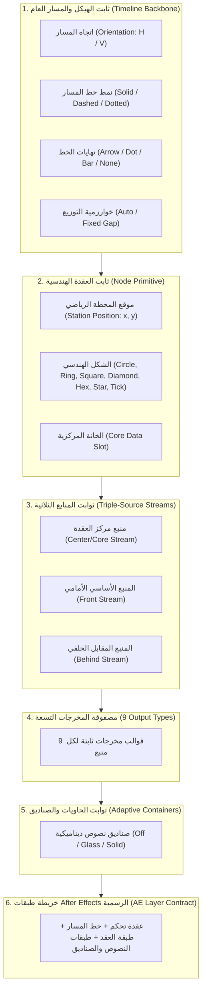

# وثيقة جرد وتجميد ثوابت نظام MASAR PRO
> **Canonical System Primitives & Architecture Freeze Specification**  
> *إصدار الوثيقة: v1.0 — تاريخ الاعتماد: 2026-11-24*

---

## 🎯 مقدمة: استراتيجية تجميد الثوابت (The Freeze Strategy)

إن قرار **جرد الثوابت وتجميدها (Primitives Freeze)** قبل التوسع في بناء نظام القوالب أو محرك الحركة هو أصح قرار هندسي لمشروع بهذا الحجم؛ والسبب هو:
1. **القالب (Template):** هو مجرد "حالة مسجلة (Serialized State)" لهذه الثوابت. إذا تغيرت الثوابت، تلفت كافة القوالب السابقة.
2. **محرك الحركة (Motion Rig):** يعمل عبر تطبيق حركات (Keyframes / Expressions) على طبقات محددة بدقة. تجميد بنية الطبقات والمنابع يجعل بناء حركات السحب والظهور والارتداد (Stagger, Trim Paths, Pop-in) عملية حسابية مباشرة ومضمونة بنسبة 100%.

---

## 🏛️ المستويات الستة لثوابت نظام MASAR



---

## 1️⃣ ثابت المسار والهيكل العام (The Timeline Axis)

يمثل العمود الفقري الذي ترتكز عليه كل الحسابات الرياضية:

| الخاصية (Property) | القيم الثابتة المعتمدة (Values) | الوصف والدور في النظام |
|---|---|---|
| `orientation` | `'horizontal'` \| `'vertical'` | اتجاه الخط الزمني بالكامل (أفقي ↔ أو عمودي ↕) |
| `spacingMode` | `'auto'` \| `'fixed'` | خوارزمية التوزيع: متكافئ على طول الكومبوزيشن أو فواصل ثابتة بالبيكسل |
| `length` | عدد صحيح بالبيكسل (افتراضي: `1500`) | الطول الإجمالي الفعال للمسار |
| `spacingGap` | عدد صحيح بالبيكسل (افتراضي: `250`) | المسافة بين محطة وأخرى في وضع `fixed` |
| `lineWidth` | عدد (1 إلى 50 px) | سماكة خط المسار الرئيسي |
| `lineColor` | كود سداسي عشر (Hex Color) | لون خط المسار الرئيسي |
| `lineStyle` | `'solid'` \| `'dashed'` \| `'dotted'` | النمط الإجرائي لرسم المسار |
| `lineCap` | `'round'` \| `'butt'` \| `'projecting'` | نهايات أطراف أجزاء الخط (مستديرة أو مسطحة) |
| `dashSize` / `dashGap`| أعداد صحيحة بالبيكسل | طول الشحطة والفراغ في النمط المتقطع |
| `startTerminal` | `'none'` \| `'arrow'` \| `'dot'` \| `'bar'` | رأس بداية المسار (سهم، نقطة، عارضة) |
| `endTerminal` | `'none'` \| `'arrow'` \| `'dot'` \| `'bar'` | رأس نهاية المسار |

---

## 2️⃣ ثابت العقدة والمحطة (The Node Primitive)

كل عقدة على المسار لها هوية وحيدة وموقع بارامتري مستقل:

* **المعرف الأساسي (`id`):** `'node_1'`, `'node_2'`, ...
* **الترتيب (`index`):** موقع العقدة في التسلسل (`0` إلى `N-1`).
* **الحالة البصرية:**
  * `customShape`: الشكل الهندسي للعقدة (`'inherit'` أو أحد الأشكال الـ 8).
  * `customColor`: لون تعبئة العقدة (فارغ يعني وراثة لون النمط العام).
  * `customStroke`: لون إطار العقدة.
  * `customSize`: قطر أو مقاس العقدة بالبيكسل.
* **الأشكال الهندسية الـ 8 المعتمدة حصراً (`SHAPE_NAMES`):**
  1. `circle` (دائرة مصمتة)
  2. `ring` (حلقة مفرغة)
  3. `square` (مربع)
  4. `diamond` (معين)
  5. `triangle` (مثلث)
  6. `hexagon` (مسدس منتظم)
  7. `star` (نجمة خماسية)
  8. `tick` (سن / شرطة عمودية مسننة)

---

## 3️⃣ ثوابت المنابع الثلاثية (Triple-Source Architecture)

تحتوي كل عقدة بداخلها على **ثلاثة منابع للمحتوى**، لا رابع لها:

```text
┌────────────────────────────────────────────────────────┐
│              [ المنبع الأساسي / الأمامي (Front Stream) ] │
│              - عنوان رئيسي (Title)                     │
│              - شرح تفصيلي / قائمة نقطية (Desc/List)     │
│              - صندوق نصي تلقائي (Title/Desc Boxes)     │
├────────────────────────────────────────────────────────┤
│                       [خط المسار]                       │
│  ───────●───────────────●────────────────●───────────  │
│     [العقدة #1]      [العقدة #2]      [العقدة #3]      │
│  [مركز العقدة]     [مركز العقدة]     [مركز العقدة]     │
│  (Core Stream)     (Core Stream)     (Core Stream)     │
├────────────────────────────────────────────────────────┤
│              [ المنبع المقابل / الخلفي (Behind Stream) ] │
│              - نصوص موازية / سنوات / بيانات تاريخية     │
│              - شارة تصنيف (Badge)                      │
│              - صندوق نصي خلفي (Behind Box)             │
└────────────────────────────────────────────────────────┘
```

### تفصيل المنابع الثلاثة:
1. **المنبع الأوسط (Center / Core Stream):**
   * **مكانه:** متطابق هندسياً مع موقع العقدة على خط المسار مباشرة.
   * **وظيفته:** حمل هوية العقدة الرقمية أو البصرية.
   * **أنماطه:** `shape_number` (شكل ورقم مدمج)، `number` (رقم فقط)، `icon` (رمز مفرغ)، `text` (رمز كودي)، أو `none` (شكل هندسي صامت).
2. **المنبع الأساسي (Front Stream):**
   * **مكانه:** في الجهة العليا (عند المسار الأفقي) أو الجهة اليمنى (عند المسار العمودي).
   * **وظيفته:** حمل النص التعريفي الرئيسي (العنوان والشرح).
   * **حاويته:** يرتبط بصندوق العنوان (`Title_Box`) وصندوق الشرح (`Desc_Box`).
3. **المنبع المقابل (Behind Stream):**
   * **مكانه:** في الجهة السفلى (أفقي) أو الجهة اليسرى (عمودي) في الاتجاه المعاكس للمنبع الأساسي.
   * **وظيفته:** حمل معلومات ثانوية موازية (مثل: التاريخ المقابل، اسم المسؤول، أو حالة الإنجاز).
   * **حاويته:** يرتبط بصندوق خلفي مستقل (`Behind_Box`).

---

## 4️⃣ مصفوفة المخرجات التسعة المعتمدة (The 9 Output Presets)

يمتلك المنبعان (الأساسي والمقابل) خياراً للتحول إلى أحد الأنماط الـ 9 التالية حصراً:

| المعرف (`type`) | اسم النمط | الحقول المستخرجة في البيانات | الطبقات الناتجة في After Effects |
|---|---|---|---|
| `title_text` | 📄 عنوان رئيسي + شرح تفصيلي | `title`, `text` | طبقة عنوان + طبقة شرح + صناديقهما |
| `title_list` | 📑 عنوان رئيسي + قائمة نقاط | `title`, `items: []` | طبقة عنوان + طبقة قائمة أسطر نقطية + صندوق |
| `title` | 🔤 عنوان رئيسي فقط | `title` | طبقة عنوان مفردة + صندوق مخصص |
| `text` | 📝 شرح / نص تفصيلي فقط | `text` | فقرة نصية مفردة + صندوق قراءة |
| `list` | 📋 قائمة نقطية فقط | `items: []` | أسطر نقطية تبدأ برموز bullet تلقائية |
| `number_title`| 🔢 رقم / ترقيم + عنوان | `number`, `title` | رقم مرحلة بخط بارز يليه العنوان |
| `number_text` | 📊 نسبة / مؤشر + بيان | `number`, `text` | مؤشر إحصائي (مثل: +45%) يليه بيان توضيحي |
| `icon_title` | ⭐ أيقونة / رمز + عنوان | `value/icon`, `title` | رمز أيقونة مدمجة بجانب العنوان |
| `badge` | 🏷️ شارة مميزة (Badge) | `text` | نص كبسولة ملون محاط بإطار بارز |

---

## 5️⃣ ثوابت الحاويات والصناديق التلقائية (Adaptive Boxes)

تتكيف الصناديق هندسياً عبر Dynamic Expressions تعتمد على `sourceRectAtTime()`:

* **الأنماط العامة (`boxMode`):**
  * `'off'`: نصوص حرة بدون خلفيات.
  * `'glass'`: صناديق زجاجية شبه شفافة (تعبئة منخفضة وإطار مضيء).
  * `'solid'`: صناديق معتمة ومصمتة عالية التباين.
* **معاملات القياس الثابتة لكل صندوق:**
  * `fillColor` & `fillOpacity` (لون وشفافية التعبئة).
  * `strokeColor`, `strokeWidth`, & `strokeOpacity` (لون وسماكة وشفافية الإطار).
  * `radius` (نصف قطر استدارة الزوايا: 0 إلى 50 px).
  * `paddingH` & `paddingV` (هوامش الحشو الداخلية الأفقية والعمودية).

---

## 6️⃣ خريطة طبقات After Effects الرسمية (AE Layer Contract)

لكل مشروع يتم بناؤه في After Effects، تتولد الطبقات بالأسماء والقواعد الثابتة التالية:

### الطبقات العامة المشتركة:
1. **`MASAR_CTRL` (Null Layer):**
   * الطبقة الأم الحاكمة في أعلى الكومبوزيشن.
   * تحتوي على جميع سلايدرات التحكم ومؤشرات الألوان وإحداثيات البداية والنهاية.
2. **`MS_Baseline` (Shape Layer):**
   * خط المسار المتصل الذي يربط المحطات ببعضها.
3. **`MS_Nodes` (Shape Layer):**
   * تحتوي داخلياً على Shape Groups باسم `Node_1`, `Node_2`, ... `Node_N`.

### طبقات كل عقدة ($i$ من 1 إلى $N$):
* **`MS_Node_${i}_Num`:** طبقة النص أو الرمز لمركز العقدة.
* **`MS_Node_${i}_Title`:** طبقة العنوان للمنبع الأساسي.
* **`MS_Node_${i}_Desc`:** طبقة الشرح أو القائمة النقطية.
* **`MS_Node_${i}_Behind`:** طبقة النص للمنبع المقابل.
* **`MS_Node_${i}_Title_Box`:** طبقة شكل الصندوق الخاص بالعنوان.
* **`MS_Node_${i}_Desc_Box`:** طبقة شكل الصندوق الخاص بالشرح.
* **`MS_Node_${i}_Behind_Box`:** طبقة شكل الصندوق للمنبع المقابل.

---

## 🎬 الأثر المباشر على بناء "محرك الحركة" (Animation Engine)

بفضل هذا التجميد الدقيق، أصبحت أسماء ومسارات الطبقات متطابقة وثابتة 100%. محرك الحركة لن يحتاج لأي تخمين، بل سينفذ حركات معيارية محددة:

```text
[الزمن 0.0s] ──> كشف المسار: Trim Paths على طبقة MS_Baseline (من 0% إلى 100%)
[الزمن 0.5s] ──> انبثاق العقدة: Pop Scale (0% -> 115% -> 100%) لمجموعة Node_i
[الزمن 0.7s] ──> ظهور المنبع الأمامي: Slide + Fade للطبقتين MS_Node_i_Title و Title_Box
[الزمن 0.9s] ──> استطالة الشرح: توسع تدريجي لـ Desc_Box مع ظهور أسطر النصوص
[الزمن 1.1s] ──> ظهور المنبع الخلفي: انزلاق ناعم من الاتجاه المعاكس لـ MS_Node_i_Behind
```

كل هذه الحركات ستكون عبارة عن "حزم حركية (Motion Profiles)" تطبق مباشرة على هذه الطبقات السبع الثابتة!

---

## ✅ خلاصة القرار

بهذه الوثيقة، نعتبر أن:
1. **هيكل العقدة والمنابع والمخرجات مكتمل وثابت 100%.**
2. **شجرة الطبقات في After Effects محكومة بعقد برمجي لا يتغير.**
3. **الخطوة التالية فوراً:** بناء نظام القوالب ونظام الحركة فوق هذه الأرضية الصلبة دون خوف من أي تعارض مستقبلي.
