# 🎛️ الدليل المرجعي لجرد متحكمات نظام MASAR PRO
> **Comprehensive System Controllers Inventory & Multi-Tier Audit**  
> *جرد دقيق ومفصل لكل متحكم يضبط ثوابت النظام العشرة — من واجهة المستخدم إلى قلب After Effects*  
> *تاريخ الاعتماد: 24 نوفمبر 2026*

---

## 🧭 مستويات التحكم الثلاثة في هندسة MASAR PRO (The 3-Tier Architecture)

لكل ثابت من ثوابت النظام، يتوفر التحكم عبر **3 طبقات متزامنة لحظياً (Real-Time Reactive Pipeline)**:

```mermaid
flowchart LR
    subgraph Tier1 ["الطبقة 1: واجهة المستخدم (CEP UI)"]
        UI_Sliders["سلايدرات ومدخلات رقمية"]
        UI_Buttons["أزرار أنماط وأيقونات تفاعلية"]
        UI_Colors["منتقيات ألوان دقيقة"]
        UI_HUD["مسطرة HUD تفاعلية"]
    end

    subgraph Tier2 ["الطبقة 2: كائن الحالة (Reactive State Store)"]
        State_Obj["activeState Object"]
        State_Storage["LocalStorage Persistence"]
        State_JSON["JSON Presets & Templates"]
    end

    subgraph Tier3 ["الطبقة 3: بيئة After Effects (Host Engine)"]
        AE_Null["MASAR_CTRL (Transform Null)"]
        AE_Shapes["Vector Shapes & Terminals"]
        AE_FX["ADBE Expression Controls"]
        AE_Exp["sourceRect Dynamic Expressions"]
    end

    Tier1 -->|"Event Listeners"| Tier2
    Tier2 -->|"csInterface / JSON Dispatch"| Tier3
    Tier3 -.->|"Live Sync / Bi-directional"| Tier1
```

---

## 📊 جدول الجرد الشامل لكافة متحكمات الثوابت (The Complete Inventory Matrix)

### 1️⃣ المستقيم الهيكلي (The Baseline Backbone)

| الثابت الفرعي | متحكم واجهة المستخدم (UI Control) | معرف العنصر (HTML ID) | متغير كائن الحالة (State Property) | المتحكم والخاصية في After Effects |
| :--- | :--- | :--- | :--- | :--- |
| **اتجاه المسار** | أزرار أيقونية (عمودي ↕ / أفقي ↔) | `#seg-orientation` | `state.orientation` ('horizontal'/'vertical') | حساب مسار `lineShape.vertices` وتوزيع العقد |
| **طريقة التوزيع** | أزرار أيقونية (تلقائي متساوٍ / تباعد ثابت) | `#seg-spacing` | `state.spacingMode` ('auto'/'fixed') | معادلة التباعد `step = len / (count-1)` أو `spacingGap` |
| **طول المسار** | سلايدر + حقل رقمي (400 - 4000 px) | `#rng-length` / `#inp-length` | `state.length` | حساب `halfLen = length / 2` لرسم طرفي المستقيم |
| **تباعد العقد** | سلايدر + حقل رقمي (50 - 1500 px) | `#rng-gap` / `#inp-gap` | `state.spacingGap` | تباعد العقد الخطي في النمط الثابت |
| **سماكة الخط** | سلايدر + حقل رقمي (1 - 30 px) | `#rng-line-w` / `#inp-line-w` | `state.lineWidth` | خاصية `ADBE Vector Stroke Width` في `MS_Baseline` |
| **لون الخط** | مربع لون منبثق (Color Swatch) | `#inp-line-color` (`#wrap-line-color`) | `state.lineColor` | خاصية `ADBE Vector Stroke Color` في `MS_Baseline` |
| **نمط الخط** | أزرار أيقونية (مصمت / متقطع / منقط) | `#seg-line-style` | `state.lineStyle` ('solid'/'dashed'/'dotted') | تفعيل/تعطيل `ADBE Vector Stroke Dashes` |
| **حافة الخط** | أزرار أيقونية (حادة / دائرية / مربعة) | `#seg-line-cap` | `state.lineCap` ('butt'/'round'/'projecting') | خاصية `LineCap` في ستروك شيب `MS_Baseline` |
| **حجم الشرطة** | سلايدر + حقل رقمي (2 - 60 px) | `#rng-dash-size` / `#inp-dash-size` | `state.dashSize` | قيمة `Dash` في مصفوفة تقطيع الستروك |
| **فراغ الشرطة** | سلايدر + حقل رقمي (3 - 60 px) | `#rng-dash-gap` / `#inp-dash-gap` | `state.dashGap` | قيمة `Gap` في مصفوفة تقطيع الستروك |

---

### 2️⃣ نهايات المستقيم (The Baseline Terminals)

| الثابت الفرعي | متحكم واجهة المستخدم (UI Control) | معرف العنصر (HTML ID) | متغير كائن الحالة (State Property) | المتحكم والخاصية في After Effects |
| :--- | :--- | :--- | :--- | :--- |
| **طرف البداية** | مجموعة أزرار أيقونية (بدون / سهم / نقطة / سن) | `#seg-start-terminal` | `state.startTerminal` ('none'/'arrow'/'dot'/'bar') | دالة `addShapeTerminal` عند النقطة `startPt` في `MS_Baseline` |
| **طرف النهاية** | مجموعة أزرار أيقونية (بدون / سهم / نقطة / سن) | `#seg-end-terminal` | `state.endTerminal` ('none'/'arrow'/'dot'/'bar') | دالة `addShapeTerminal` عند النقطة `endPt` في `MS_Baseline` |
| **حجم النهايات** | مشتق تلقائياً بنسبة متناسقة مع سماكة الخط | داخلي (تلقائي) | مشتق من `lineWidth` | حساب أبعاد الفيكتور `terminalSize` تلقائياً |

---

### 3️⃣ صناديق النصوص التكيفية (Adaptive Text Boxes)

| الثابت الفرعي | متحكم واجهة المستخدم (UI Control) | معرف العنصر (HTML ID) | متغير كائن الحالة (State Property) | المتحكم والخاصية في After Effects |
| :--- | :--- | :--- | :--- | :--- |
| **النمط العام للصناديق** | أزرار أيقونية (بدون / زجاجي / صلب) | `#seg-box-mode` | `state.boxMode` ('off'/'glass'/'solid') | تفعيل/تعطيل وتطبيق الشفافية على طبقات الصناديق |
| **صندوق العنوان: الشفافية** | سلايدر + حقل نسبة (0 - 100 %) | `#rng-title-box-fill-op` / `#inp-title-box-fill-op` | `state.titleBoxFillOpacity` | سلايدر `Fill Opacity` (ADBE Slider Control) على الطبقة |
| **صندوق العنوان: لون التعبئة** | مربع لون منبثق | `#inp-title-box-fill-color` | `state.titleBoxFillColor` | متحكم لون `Fill Color` (ADBE Color Control) على الطبقة |
| **صندوق العنوان: تدوير الزوايا** | سلايدر + حقل نصف قطر (0 - 30 px) | `#rng-title-box-radius` / `#inp-title-box-radius` | `state.titleBoxRadius` | سلايدر `Corner Radius` (ADBE Slider Control) على الطبقة |
| **صندوق العنوان: لون الإطار** | مربع لون منبثق | `#inp-title-box-stroke-color` | `state.titleBoxStrokeColor` | متحكم لون `Stroke Color` (ADBE Color Control) على الطبقة |
| **صندوق الشرح: الشفافية** | سلايدر + حقل نسبة (0 - 100 %) | `#rng-desc-box-fill-op` / `#inp-desc-box-fill-op` | `state.descBoxFillOpacity` | سلايدر `Fill Opacity` (ADBE Slider Control) على الطبقة |
| **صندوق الشرح: لون التعبئة** | مربع لون منبثق | `#inp-desc-box-fill-color` | `state.descBoxFillColor` | متحكم لون `Fill Color` (ADBE Color Control) على الطبقة |
| **صندوق الشرح: تدوير الزوايا** | سلايدر + حقل نصف قطر (0 - 30 px) | `#rng-desc-box-radius` / `#inp-desc-box-radius` | `state.descBoxRadius` | سلايدر `Corner Radius` (ADBE Slider Control) على الطبقة |
| **صندوق الشرح: لون الإطار** | مربع لون منبثق | `#inp-desc-box-stroke-color` | `state.descBoxStrokeColor` | متحكم لون `Stroke Color` (ADBE Color Control) على الطبقة |
| **الهامش الأفقي للحاشية** | مدمج في سلايدر `Padding H` | ضبط داخلي / درج التخصيص | `state.boxPaddingH` (Default: 14) | سلايدر `Padding H` على طبقة الصندوق بتعبير `sourceRect` |
| **الهامش الرأسي للحاشية** | مدمج في سلايدر `Padding V` | ضبط داخلي / درج التخصيص | `state.boxPaddingV` (Default: 6) | سلايدر `Padding V` على طبقة الصندوق بتعبير `sourceRect` |
| **تخصيص صندوق كل محطة** | أزرار تخصيص بدرج كل بطاقة | درج بطاقة العقدة | `node.boxMode` و `node.titleBox*` | تطبيق مباشر ومستقل على طبقة `MS_Node_i_*_Box` الخاصة بها |

---

### 4️⃣ العقدة والمحطة الهندسية (Node & 8 Shapes)

| الثابت الفرعي | متحكم واجهة المستخدم (UI Control) | معرف العنصر (HTML ID) | متغير كائن الحالة (State Property) | المتحكم والخاصية في After Effects |
| :--- | :--- | :--- | :--- | :--- |
| **منتقي الأشكال العام** | نافذة منبثقة تفاعلية + معاينة حية | `#btn-global-shape-trigger` + `#modal-shapes` | `state.nodeShape` (8 أشكال + SVG) | مجموعات الفيكتور داخل طبقة `MS_Nodes` |
| **حجم العقدة** | سلايدر + حقل رقمي (4 - 60 px) | `#rng-circ-r` / `#inp-circ-r` | `state.circleRadius` | أبعاد الشيب الهندسي `ADBE Vector Rect Size` / `Radius` |
| **لون تعبئة العقدة** | مربع لون منبثق | `#inp-circ-fill` (`#wrap-circ-fill`) | `state.circleFill` | خاصية `ADBE Vector Fill Color` في مجموعة العقدة |
| **سماكة إطار العقدة** | سلايدر + حقل رقمي (0 - 15 px) | `#rng-circ-sw` / `#inp-circ-sw` | `state.circleStrokeWidth` | خاصية `ADBE Vector Stroke Width` في مجموعة العقدة |
| **لون إطار العقدة** | مربع لون منبثق | `#inp-circ-stroke` (`#wrap-circ-stroke`) | `state.circleStroke` | خاصية `ADBE Vector Stroke Color` في مجموعة العقدة |
| **ارتفاع السن (Tick Height)** | سلايدر + حقل رقمي (8 - 120 px) | `#rng-tick-h` / `#inp-tick-h` | `state.tickHeight` | دالة `addShapeTick` برسم السن المتعامد على المسار |
| **عرض ولون السن** | سلايدر + مربع لون | `#rng-tick-w` / `#inp-tick-color` | `state.tickWidth`, `state.tickColor` | سمك ولون خط الـ Stroke الخاص بالسن |
| **تخصيص شكل العقدة المنفردة** | زر شيب بيضاوي داخل بطاقة العقدة | `.node-shape-pill` | `node.customShape`, `node.customColor` | تفريع الكود في الدورة `EffShape` لإنشاء شكل مستقل لكل عقدة |

---

### 5️⃣ المنابع الثلاثية (Triple-Source Streams)

| الثابت الفرعي | متحكم واجهة المستخدم (UI Control) | كائن الحالة (State Property) | المتحكم والخاصية في After Effects |
| :--- | :--- | :--- | :--- |
| **المنبع الأوسط (Center)** | قسم المنبع الأوسط بدرج بطاقة العقدة | `node.sources.center` (`type`, `value`, `icon`, `visible`) | طبقة النص **`MS_Node_i_Num`**، محاذاة في المركز بالضبط بتعبير `sourceRectAtTime` |
| **المنبع الأمامي (Front)** | حقول العنوان والشرح والقوائم بالبطاقة | `node.sources.front` (`type`, `title`, `text`, `items`, `badge`, `icon`) | طبقات **`MS_Node_i_Title`** و **`MS_Node_i_Desc`** المتموضعة على المحور الأمامي |
| **المنبع الخلفي (Behind)** | قسم المنبع الخلفي بدرج بطاقة العقدة | `node.sources.behind` (`type`, `title`, `text`, `items`, `badge`, `icon`) | طبقة **`MS_Node_i_Behind`** المتموضعة على الجانب المتعامد المعاكس |
| **حجم ولون الرقم الداخلي** | سلايدر + مربع لون | `state.numberFontSize`, `state.numberColor` | خاصية `fontSize` و `fillColor` في `TextDocument` الخاص بطبقة `Num` |

---

### 6️⃣ مصفوفة المخرجات التسعة (The 9-State Output Tensor)

| نمط الإخراج (Preset) | متحكم الاختيار في اللوحة (UI Selector) | كود الحالة (State Type) | التمثيل الطبقي في After Effects |
| :--- | :--- | :--- | :--- |
| `title_text` (عنوان وشرح) | قائمة منسدلة داخل المنبع الأمامي/الخلفي | `type: "title_text"` | تفعيل طبقتي Title و Desc معاً مع تباعد محسوب |
| `title_list` (عنوان وقائمة نقاط) | قائمة منسدلة داخل المنبع | `type: "title_list"` | تفعيل Title و Desc مع توليد نقاط التعداد `\u2022` تلقائياً |
| `title` (عنوان مفرد) | قائمة منسدلة داخل المنبع | `type: "title"` | تفعيل طبقة Title وتعطيل Desc |
| `text` (شرح مفرد) | قائمة منسدلة داخل المنبع | `type: "text"` | تعطيل طبقة Title وتفعيل طبقة Desc |
| `list` (قائمة نقاط بدون عنوان) | قائمة منسدلة داخل المنبع | `type: "list"` | تفعيل طبقة Desc فقط وتنسيقها كنقاط تعداد نقطية |
| `number_title` (شارة رقمية مع عنوان) | قائمة منسدلة داخل المنبع | `type: "number_title"` | دمج الشارة الرقمية مع العنوان في سطر واحد بنص عريض |
| `number_text` (شارة رقمية مع شرح) | قائمة منسدلة داخل المنبع | `type: "number_text"` | دمج الشارة الرقمية مع نص الشرح |
| `icon_title` (أيقونة مع عنوان) | قائمة منسدلة داخل المنبع | `type: "icon_title"` | دمج رمز الأيقونة مع نص العنوان |
| `badge` (شارة كبسولية مستقلة) | قائمة منسدلة داخل المنبع | `type: "badge"` | تفعيل صندوق مصغر ملائم لحجم الشارة فقط |

---

### 7️⃣ النصوص والإزاحات والتموضع (Typography & Layout)

| الثابت الفرعي | متحكم واجهة المستخدم (UI Control) | معرف العنصر (HTML ID) | متغير كائن الحالة (State Property) | المتحكم والخاصية في After Effects |
| :--- | :--- | :--- | :--- | :--- |
| **خط العنوان** | سلايدر + حقل (12 - 60 pt) + لون | `#rng-title-size` / `#inp-title-color` | `state.titleFontSize`, `state.titleColor` | خصائص `fontSize` و `fillColor` بطبقة Title |
| **خط الشرح** | سلايدر + حقل (9 - 36 pt) + لون | `#rng-desc-size` / `#inp-desc-color` | `state.descFontSize`, `state.descColor` | خصائص `fontSize` و `fillColor` بطبقة Desc |
| **جهة التموضع** | أزرار أيقونية (يسار / متناوب / يمين) | `#seg-content-side` | `state.contentSide` ('left'/'alternate'/'right') | تحديد إشارة الإزاحة الرياضية (+ أو -) عن المستقيم |
| **محاذاة النصوص** | أزرار أيقونية (تلقائي / يمين / وسط / يسار) | `#seg-text-align` | `state.textAlign` ('auto'/'right'/'center'/'left') | خاصية `tDoc.justification` (Paragraph Justification) |
| **إزاحة الخلوص الأمامي** | سلايدر + حقل (5 - 100 px) | `#rng-top-offset` / `#inp-top-offset` | `state.topOffset` | معادلة `topClear = nodeExtent + topOffset + 4` |
| **إزاحة الخلوص الخلفي** | سلايدر + حقل (5 - 100 px) | `#rng-bot-offset` / `#inp-bot-offset` | `state.bottomOffset` | معادلة `botClear = nodeExtent + bottomOffset + 4` |

---

### 8️⃣ المتحكم العام الحاكم (Master Controller Null)

| الثابت الفرعي | متحكم واجهة المستخدم (UI Control) | كائن الحالة (State) | المتحكم والخاصية في After Effects |
| :--- | :--- | :--- | :--- |
| **المزامنة الفورية (Live Sync)** | زر كبسولي عائم مع مؤشر نبضي | `state.liveSync` (true/false) | مستمع أحداث التحديث الفوري المباشر للكومبوزيشن |
| **التطبيق والتحديث (Generate)** | زر رئيسي أخضر في شريط الإجراءات | استدعاء `TR.API.generate()` | إطلاق عملية التحديث الذكي الموضعي (In-Place Update) |
| **إعادة البناء والتوسيط (Rebuild)** | زر ثانوي في شريط الإجراءات | استدعاء `TR.API.generate(forceRebuild=true)` | مسح وإعادة بناء شبكة الطبقات وتوسيطها في الكومب |
| **موضع وتوسيط النظام ككل** | تلقائي حسب مركز الكومبوزيشن | مركز الكومب `[w/2, h/2]` | خاصية `Position` و `Anchor Point` لطبقة **`MASAR_CTRL`** |
| **المقياس والدوران العام** | موروث فيزائياً لكل الطبقات | تحكم حر للمصمم في AE | خصائص `Scale` و `Rotation` لطبقة **`MASAR_CTRL`** (لأن كل الطبقات تابعة لها كـ Parent) |

---

### 9️⃣ مسطرة الـ HUD التفاعلية المزدوجة (Dual-Axis HUD)

| الثابت الفرعي | متحكم واجهة المستخدم (UI Control) | معرف العنصر (HTML ID) | الوظيفة التفاعلية |
| :--- | :--- | :--- | :--- |
| **الكانفاس الأفقي العلوي** | كانفاس تفاعلي أعلى التبويب الأول | `#timeline-hud-canvas` | يظهر عند اختيار المسار الأفقي، يدعم النقر لاختيار العقدة، وسحب العقد لتعديل مواقعها |
| **المجرى العمودي الجانبي** | شريط تفاعلي يمين التبويب الأول | `#hud-vertical-rail` | يظهر عند اختيار المسار العمودي، يعكس المواقع النسبية للعقد بالتمام |
| **زر زاوية التبديل السريع** | زر أيقوني في ركن مسطرة الـ HUD | `#btn-hud-corner` | التبديل الفوري بنقرة واحدة بين المسار الأفقي والمسار العمودي |

---

### 🔟 محرك إدارة المحطات والبيانات (Data Orchestration)

| الثابت الفرعي | متحكم واجهة المستخدم (UI Control) | معرف العنصر (HTML ID) | الوظيفة البرمجية |
| :--- | :--- | :--- | :--- |
| **إضافة عقدة جديدة** | زر أخضر بارز بشريط أدوات العقد | `#btn-add-node` | إضافة عنصر لمصفوفة `state.nodes[]` وتحديث الواجهة والـ AE |
| **الاستيراد الدفعي السريع** | نافذة منبثقة ذكية مع محددات الفاصلة | `#btn-open-batch-import` + `#modal-batch-import` | توزيع مصفوفة نصوص متعددة الأسطر مع فاصل `\|` إلى العقد |
| **قلب الترتيب (Reverse)** | زر شريط الأدوات | `#btn-reverse-nodes` | عكس مصفوفة المحطات فورياً مع الحفاظ على البيانات المخصصة |
| **شرائح الترقيم التلقائي** | شرائح سريعة بشريط الأدوات | `.pattern-chip` (`num-01`, `years`, إلخ) | توليد تسلسل أرقام أو سنوات بنقرة واحدة لجميع المحطات |
| **إعادة الترتيب بالسحب** | خاصية السحب والإفلات لكل بطاقة | `draggable="true"` على `.node-card` | إعادة ترتيب المحطات فيزيائياً بالسحب وتحديث الكومبوزيشن |

---

## 💡 خلاصة الجرد والتوصية المعمارية

1. **نسبة توفر المتحكمات:** **100% كاملة**. كل ثابت تم ذكره في الوثيقة المرجعية يملك متحكمات مخصصة في واجهة الإضافة، ومتغيرات تفاعلية في كائن الحالة، وآليات ربط دقيقة في After Effects.
2. **الربط الحاكم:** جميع طبقات النظام في After Effects (المستقيم، العقد، النصوص، والصناديق) ترتبط بطبقة النل الحاكمة **`MASAR_CTRL`** كـ Parent، مما يسمح بتحريك وتكبير وتدوير المخطط كاملاً ككتلة فيزيائية واحدة.
3. **متحكمات الصناديق في After Effects:** الصناديق التكيفية مزودة بالفعل بمتحكمات حقيقية من نوع `ADBE Slider Control` و `ADBE Color Control` داخل لوحة Effect Controls في After Effects.
