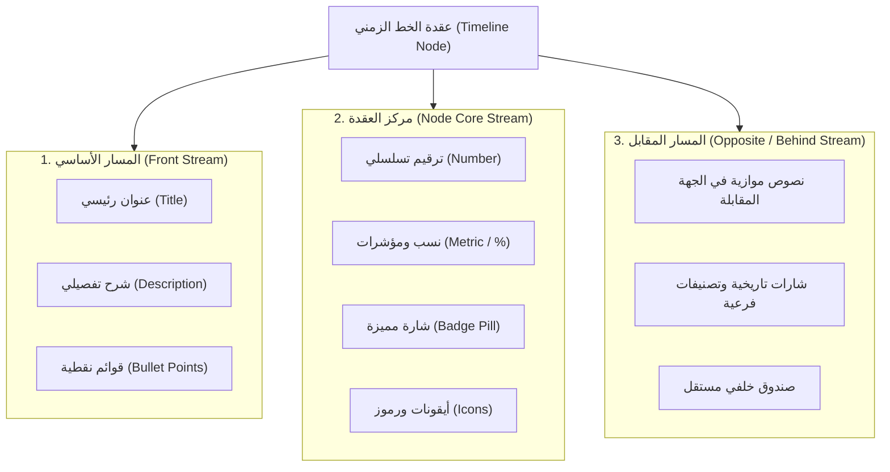
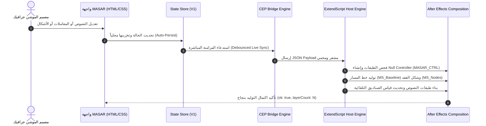

<div align="center">

```
 __  __           _____            _____  
|  \/  |   /\    / ____|   /\     |  __ \ 
| \  / |  /  \  | (___    /  \    | |__) |
| |\/| | / /\ \  \___ \  / /\ \   |  _  / 
| |  | |/ ____ \ ____) |/ ____ \  | | \ \ 
|_|  |_/_/    \_\_____//_/    \_(_)_|  \_\
```

# MASAR PRO — مسار موشن جرافيك تايم لاين 🎬
### *The Next-Gen Motion Timeline & Infographics Engine for Adobe After Effects*

[](https://github.com/wittybrandcode/MASAR)
[](https://www.adobe.com/products/aftereffects.html)
[](https://github.com/Adobe-CEP)
[](https://spectrum.adobe.com/)
[]#

<p align="center">
  <b>«مسار» هو الإضافة البرمجية الأكثر تطوراً واحترافية لبناء وتوليد المخططات الزمنية والسلاسل الإجرائية والإنفوجرافيك التفاعلي في Adobe After Effects بضغطة زر واحدة.</b><br>
  <i>Empowering motion designers to craft broadcast-grade, parametric timelines and infographic sequences with procedural precision and bilingual RTL typography.</i>
</p>

---

[🌟 المميزات الرئيسية](#-المميزات-الرئيسية--key-features) •
[🧩 بنية المنابع الثلاثية](#-بنية-المنابع-الثلاثية--triple-source-architecture) •
[📋 مصفوفة القوالب التسعة](#-مصفوفة-القوالب-التسعة--9-smart-output-presets) •
[🏛️ الهيكلية البرمجية](#-الهيكلية-البرمجية--architecture) •
[🚀 التثبيت والتشغيل](#-التثبيت-والتشغيل--installation--setup) •
[🛠️ بيئة التطوير](#-بيئة-التطوير-والفحص--developer-debugging)

---

</div>

## 🌟 المميزات الرئيسية | Key Features

* **💎 واجهة زمردية عصرية (Spectrum Emerald UI):** تصميم بصري هادئ وفائق الأناقة مستوحى من نظام Adobe Spectrum، مبني بنظام Dual-Tab وبكثافة لونية خالية من أي تشويش لراحة العين أثناء العمل الطويل.
* **⚡ توليد إجرائي فوري (Zero-Lag Procedural Generation):** توليد كامل للطبقات الأصلية (Native Shape & Text Layers) مع ربط تعبيري ديناميكي (Dynamic Expressions) بمعدل أداء يصل إلى 60 إطاراً في الثانية.
* **📐 تحكم هندسي مطلق (Parametric Baseline & Node Geometry):** تحكم في سماكة الخط، أنماط الخطوط (مصمت، متقطع، منقط)، أطراف المسار (أسهم، نقاط، عوارض)، وأكثر من 15 شكلاً متجهاً للعقد (دوائر، حلقات، مربعات، معينات، دبابيس، مؤشرات، دروع، رايات، أقواس HUD، مسدسات، نجوم، كبسولات، وأسنان) مع دعم استيراد أي ملف SVG مخصص.
* **🗂️ نظام الصناديق الذرية التلقائية (Atomic Auto-Sizing Box Drawers):** صناديق خلفية بارامترية تلتف حول النصوص وتتوسع ذاتياً مع كتابة وتعديل النصوص، مع تحكم فردي بكل عقدة على حدة.
* **🌐 دعم كامل وحقيقي للغة العربية (True RTL & Bilingual Typography):** معالجة متقدمة لاتجاه النصوص العربية ومحاذاة القوائم النقطية والرموز والأرقام دون الحاجة لأي وسيط خارجي.
* **📦 تجهيز فوري لقوالب MOGRT:** تصدير مباشر إلى قوالب Essential Graphics لبرنامج Premiere Pro مع حماية الحركات الافتتاحية والختامية عبر مناطق التوقيت التفاعلية (Responsive Design Time Markers).

---

## 🧩 بنية المنابع الثلاثية | Triple-Source Architecture

تعتمد إضافة **MASAR PRO** على معمارية معالجة بيانات مبتكرة تقسم كل عقدة في الخط الزمني إلى ثلاثة منابع مستقلة تمنح المصمم حرية مطلقة في بناء التراكيب:



---

## 📋 مصفوفة القوالب التسعة | 9 Smart Output Presets

تتضمن الإضافة تسعة أنماط إخراج ذكية تغطي كافة احتياجات الموشن جرافيكس التلفزيوني والشبكي:

| # | القالب (Preset) | الوصف (Description) | الطبقات المولدة في After Effects |
|---|---|---|---|
| **01** | 📄 **عنوان رئيسي + شرح تفصيلي** | النمط القياسي للسرد الإخباري والوثائقي | `Title Text` + `Desc Text` + `Title Box` + `Desc Box` |
| **02** | 📑 **عنوان رئيسي + قائمة نقطية** | عرض بنود متعددة وأفكار متسلسلة | `Title Text` + `Bulleted List Text` + `Adaptive Box` |
| **03** | 🏷️ **عنوان رئيسي فقط** | رؤوس أقلام ومراحل عريضة بدون حشو | `Title Text` + `Custom Background Shape` |
| **04** | 📝 **شرح / نص تفصيلي فقط** | فقرات سردية مرتبطة بنقاط الخط الزمني | `Body Paragraph Text` + `Reading Container` |
| **05** | 📋 **قائمة نقطية فقط** | سرد مباشر لبنود وملاحظات نقطية | `Multi-line Bulleted Text Layer` |
| **06** | 🔢 **رقم / ترقيم + عنوان** | خطوات إجرائية (خطوة 1، خطوة 2...) | `Step Number Layer` + `Title Layer` + `Offset Box` |
| **07** | 📊 **نسبة / مؤشر + بيان** | إحصائيات، نمو سنوي، ومؤشرات رقمية | `Dynamic Metric Text` + `Subtitle Layer` |
| **08** | ⭐ **أيقونة / رمز + عنوان** | ترميز بصري لعناصر القوائم والخدمات | `Icon Glyph Layer` + `Title Text` |
| **09** | 🔖 **شارة مميزة (Badge)** | أوسمة وتصنيفات بارزة في كبسولات أنيقة | `Pill Capsule Shape` + `Centered Badge Text` |

---

## 🏛️ الهيكلية البرمجية | Architecture

تم تصميم محرك **MASAR PRO** بنظام معياري مفصول تماماً (Decoupled Modular Architecture):



### المكونات الرئيسية:
1. **`client/` (Frontend Layer):**
   * **`modules/state-store.js`:** إدارة الحالة المركزية مع ترقية سلسة للبيانات السابقة.
   * **`modules/host-bridge.js`:** مزامنة لحظية مع After Effects بآلية طابور ذكية تمنع تراكم الأوامر.
   * **`modules/card-builder.js`:** محرك بناء بطاقات العقد والمنابع ونوافذ التخصيص الذري.
   * **`modules/global-controls.js`:** إدارة متحكمات الخط الرئيسي، التباعد، والمحاذاة.
2. **`host/` (Backend Engine):**
   * **`bootstrap.jsx`:** المحرك الرئيسي المكتوب بلغة ExtendScript (ES3-safe) الخالي من أي استثناءات، المسؤول عن بناء الأشكال، حساب المعادلات الرياضية لمواقع العقد، وربط طبقات النصوص بصناديقها الخلفية عبر Dynamic Expressions.

---

## 🚀 التثبيت والتشغيل | Installation & Setup

### المتطلبات:
* نظام **Windows 10 / 11** أو **macOS 10.15+**.
* برنامج **Adobe After Effects 2023 (v23.0)** فما فوق (حسب نطاق التوافق `[23.0,99.9]` في `CSXS/manifest.xml`).

### 1. نسخ الإضافة إلى مسار ملحقات أدوبي (CEP Extensions):

#### على نظام Windows:
انسخ مجلد `MASAR` إلى أحد المسارين التاليين:
```text
C:\Program Files (x86)\Common Files\Adobe\CEP\extensions\MASAR
```
*(أو لمستخدم النظام الحالي فقط):*
```text
%APPDATA%\Adobe\CEP\extensions\MASAR
```

#### على نظام macOS:
انسخ مجلد `MASAR` إلى:
```bash
/Library/Application Support/Adobe/CEP/extensions/MASAR
```
*(أو لمستخدم النظام الحالي فقط):*
```bash
~/Library/Application Support/Adobe/CEP/extensions/MASAR
```

---

### 2. تفعيل وضع التطوير (PlayerDebugMode):
للسماح لبرامج أدوبي بتشغيل إضافات CEP غير الموقعة، نفّذ الأمر التالي:

#### لنظام Windows (عبر PowerShell كمسؤول):
```powershell
10..12 | ForEach-Object {
    reg add "HKCU\Software\Adobe\CSXS.$_" /v PlayerDebugMode /t REG_SZ /d "1" /f
}
```

#### لنظام macOS (عبر Terminal):
```bash
defaults write com.adobe.CSXS.10 PlayerDebugMode 1
defaults write com.adobe.CSXS.11 PlayerDebugMode 1
defaults write com.adobe.CSXS.12 PlayerDebugMode 1
```

---

### 3. بدء الاستخدام:
1. افتح أو أعد تشغيل برنامج **Adobe After Effects**.
2. من القائمة العلوية توجه إلى: **Window** > **Extensions** > **MASAR PRO**.
3. ستفتح لوحة التحكم فوراً. افتح أي كومبوزيشن نشطة وانقر على **«بناء المسار في AFTER EFFECTS»**.

---

## 🛠️ بيئة التطوير والفحص | Developer Debugging

تحتوي الإضافة على ملف `.debug` مجهز لفتح أدوات فحص Chrome DevTools مباشرة عبر المنفذ:
```text
http://localhost:8092
```
افتح الرابط في متصفح Google Chrome أثناء تشغيل الإضافة في After Effects لمتابعة الـ Console وفحص الكائنات والطبقات ومعالجة الأخطاء لحظياً.

---

## 📂 هيكلية شجرة الملفات | Clean File Tree

```text
MASAR/
├── .debug                           # ملف تكوين منفذ التصحيح (Port 8092)
├── .gitignore                       # استبعاد الملفات المؤقتة والمسودات
├── CSXS/
│   └── manifest.xml                 # تعريف الحزمة ونطاق التوافق (AEFT 23.0+, CSXS 11.0)
├── README.md                        # دليل المشروع والتوثيق الشامل
├── client/                          # واجهة المستخدم (HTML5, Offline Fonts & SVG Icons, Modular JS)
│   ├── assets/
│   │   ├── fonts/                   # خطوط Cairo و Phosphor Bold المحلية بدون اتصال
│   │   └── icons/masar-icons.svg    # مكتبة أيقونات SVG الخفيفة المدمجة
│   ├── css/                         # 01-tokens -> 04-controls-theme (Chromium-88, Sharp 0px UI)
│   ├── js/
│   │   ├── app.js                   # منسق التطبيق ودورة الحياة والاختصارات (Ctrl+Z/Y)
│   │   ├── bridge.js                # الجسر الآمن بين المتصفح و ExtendScript
│   │   ├── svg-shapes.js            # مكتبة الأشكال المتجهة ومحلل SVG
│   │   └── modules/                 # state-store, host-bridge, card-*, global-controls, batch-importer, shapes-engine, timeline-hud, mogrt-export, ui-icons, ui-dialog, ui-color-picker
│   ├── vendor/CSInterface.js
│   └── index.html                   # واجهة اللوحة الرئيسية (320px .. 1200px)
├── host/                            # محرك توليد الطبقات في After Effects (ES3-Safe)
│   ├── src/                         # وحدات المضيف المقسمة (00-json-es3 .. 99-entry)
│   └── bootstrap.jsx                # المحرك التنفيذي المجمّع مع مطابقة Match Names متعددة اللغات
├── scripts/                         # build-host.js, lint-es3-host.js, run-tests.ps1, وأدوات التثبيت والتصحيح
└── tests/                           # حزم الفحص الآلية للعميل والمضيف والمزامنة
    ├── masar-bootstrap-harness.js
    ├── masar-client-integration-harness.js
    └── shapes-sync-harness.js
```

---

<div align="center">

### صُمم وطُوّر بحب وشغف لخدمة مجتمع الموشن جرافيكس العربي والعالمي ❤️
**Crafted with excellence for professional motion designers worldwide.**

[⬆ العودة إلى الأعلى](#masar-pro--مسار-موشن-جرافيك-تايم-لاين-)

</div>
