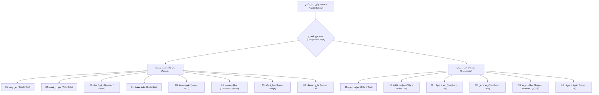
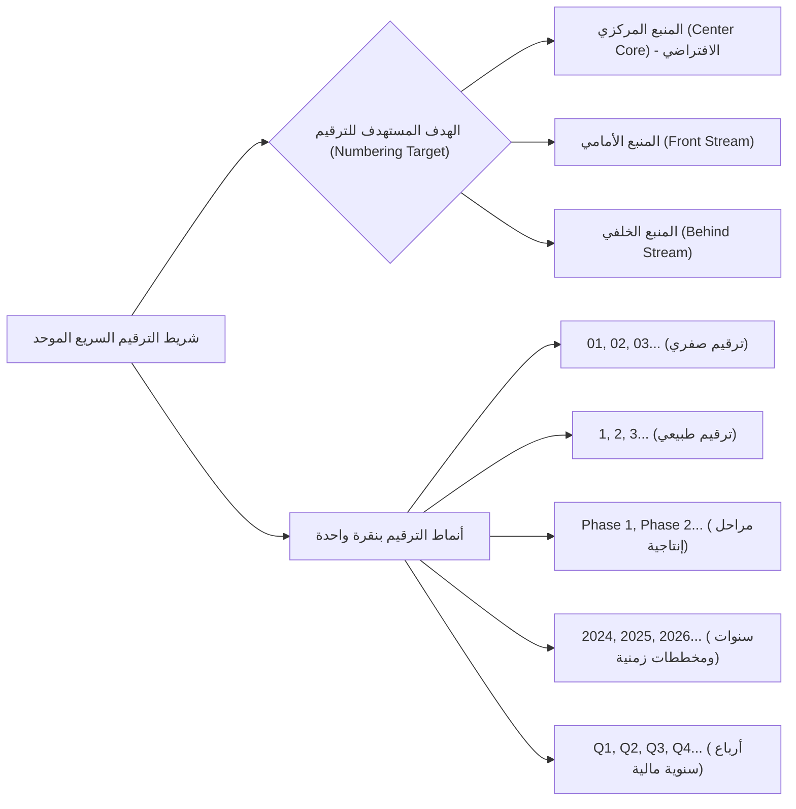

# خطة المعمارية الموحدة: نظام المنابع الثلاثية للعقد (Triple-Source Modular Node Architecture)
## مشروع TIME RULER PRO — الخطة الهندسية والتطويرية الشاملة (الإصدار 2.0 المحدث)

---

## 1. الفلسفة المعمارية ومفهوم "المنابع الثلاثية"

تقوم المعمارية على مبدأ هندسي مبتكر: **كل عقدة على المسار لم تعد سجلاً ثابتاً بحقول جامدة، بل أصبحت وحدة بث مكاني ثلاثية (Triple Spatial Broadcasting Pod)** تلتف حول نقطة الارتكاز على المسار الزمني:

```
                    ═════════════════════════════════════════
                         المنبع 1: أمام الخط / فوقه
                         (Top / Front Source)
                    ═════════════════════════════════════════
                                        ▲
                                        │  [إزاحة أمامية / علوية Y-Offset]
                                        │
───────■────────────────────────────────■────────────────────────────────■───────
(المسار الزمني)                  المنبع 2: مركز العقدة
                                  (Node Center / Core)
                                        │
                                        │  [إزاحة خلفية / سفلية Y-Offset]
                                        ▼
                    ═════════════════════════════════════════
                         المنبع 3: خلف الخط / تحته
                         (Bottom / Behind Source)
                    ═════════════════════════════════════════
```

---

## 2. تحليل واجهة المستخدم الحالية (المرجعية البصرية) ومقارنتها بالمعمارية الجديدة

بناءً على فحص عناصر الواجهة الحالية للوحة التحكم:

```
┌────────────────────────────────────────────────────────────────────────────────────────┐
│ [القوالب]       [النصوص]       [الأشكال]       [المسار]       [★ العقد 5]             │
├────────────────────────────────────────────────────────────────────────────────────────┤
│ 1500px  [ 1 ]─────────────────[ 2 ]─────────────────[ 3 ]──────────────[ 4 ]──────[ 5 ]  │
├────────────────────────────────────────────────────────────────────────────────────────┤
│ [🏷️ وسم] [Phase] [+2024] [الترقيم: 01,02]             [استيراد مخطط ⮞] [➕ إضافة عقدة]│
├────────────────────────────────────────────────────────────────────────────────────────┤
│ ┌────────────────────────────────────────────────────────────────────────────────────┐ │
│ │ [🗑️] [📋] [⌵] [⯅]  [عام (دائرة مصمتة) ▾]⚪  [البحث والتحليل     ] [01] [#1] [:::] │ │
│ │ [دراسة السوق وتحديد متطلبات المشروع والجمهور المستهدف                           ⌵] │ │
│ └────────────────────────────────────────────────────────────────────────────────────┘ │
└────────────────────────────────────────────────────────────────────────────────────────┘
```

### نقاط القوة في الواجهة الحالية التي يجب الحفاظ عليها:
1. **شريط الـ HUD العلوي للمسار (Timeline HUD):** مربعات العقد البيضاء الصريحة بحجم `24x24px` مع الأرقام السوداء والخط الأبيض وتظليل العقدة النشطة باللون الأزرق (`#1473e6`).
2. **أدوات رأس البطاقة السريعة:** زر السحب وإعادة الترتيب (`:::` Drag Handle)، شارة الفهرس (`#1`)، أزرار الحذف والنسخ والتحريك لأعلى ولأسفل.
3. **شريط الترقيم السريع (Quick Numbering Toolbar):** أزرار القوالب الرقمية المسبقة (`01, 02` و `Phase` و `+2024`).
4. **النمط الصناعي الصارم (`Industrial Spectrum Style`):** الزوايا الحادة التامة (`0px border-radius`)، ألوان الخلفية الداكنة المتناسقة (`#1a1a1a` / `#222222`)، والحدود الدقيقة `1px`.

### القيود الحالية التي تُعالجها المعمارية الجديدة:
* **جمود المحتوى:** الحقول الحالية محصورة فقط في (شكل + رقم + عنوان سطر واحد + شرح).
* **انعدام المنبع الخلفي:** لا يوجد أي مكان لإضافة تاريخ أو إحصائية أو تصنيف تحت الخط إلا بتغيير قالب المسار كلياً.
* **فقدان مرونة القوائم:** لا يمكن كتابة قائمة نقطية متعددة الأسطر داخل الشرح دون أن تفسد تنسيق سطر الإدخال.

---

## 3. مصفوفة المنابع المكانية وتكيفها التلقائي مع اتجاه المسار

| المنبع المكاني (`Source ID`) | في المسار الأفقي ↔ | في المسار العمودي ↕ | الوظيفة الدلالية البصرية | السلوك الافتراضي |
| :--- | :--- | :--- | :--- | :--- |
| **01. منبع المركز (`center`)** | على الخط مباشرة $(x_i, 0)$ | على الخط مباشرة $(0, y_i)$ | **قلب العقدة:** شكل هندسي، رقم المرحلة، أو أيقونة معبرة. | مفعل دائماً (أساس المحطة) |
| **02. منبع الأمام / الفوق (`front`)** | **أعلى الخط** $(x_i, -Y_{\text{offset}})$ | **يمين الخط / أمامه** $(+X_{\text{offset}}, y_i)$ | **المحتوى الرئيسي الأول:** عنوان رئيسي، فقرة شرح، أو قائمة مهام. | مفعل افتراضياً |
| **03. منبع الخلف / التحت (`behind`)** | **أسفل الخط** $(x_i, +Y_{\text{offset}})$ | **يسار الخط / خلفه** $(-X_{\text{offset}}, y_i)$ | **المحتوى التكميلي الثاني:** تاريخ، إحصائية، ميزانية، أو وسم حالة. | اختياري (يمكن تشغيله أو طيه) |

---

## 4. مصفوفة المكونات والتوليفات المعيارية لكل منبع

كل منبع من المنابع الثلاثة يمتلك حرية كاملة ليتحول إلى أي شكل من الأشكال التالية عبر القائمة المنسدلة للنوع:



---

## 5. المواصفات الهندسية لمتحكمات كل مخرج (UI Controls Blueprint)

تمت هندسة كل متحكم ليتلائم بدقة مع عرض لوحة CEP المحدود (~400px) دون التسبب بأي تداخل بصري:

### أ. مواصفات المخرجات البسيطة (Atomic Controls):

| نوع المخرج | طبيعة المتحكم البرمجي | الأبعاد والارتفاع | الخط والتنسيق | التفاعل وسلوك الإدخال (Micro-Interactions) |
| :--- | :--- | :--- | :--- | :--- |
| **1. رقم (`number`)** | `input[type="text"]` رقمي | ارتفاع `28px`، عرض مرن `65px - 90px` | `800 13px "Cairo", monospace`، محاذاة في المنتصف | يقبل: أرقام عادية (`01`, `1`)، نسب مئوية (`+85%`)، مبالغ (`$50K`)، أو صيغ زمنية (`Q1`, `2025`). |
| **2. عنوان رئيسي (`title`)** | `input[type="text"]` سطر واحد | ارتفاع `30px`، بعرض كامل `100%` | `700 13.5px "Cairo"`، لون أبيض ناصع `#ffffff` | شريط مؤشر جانبي بلون الـ Accent، وتوسيط بصري تلقائي. |
| **3. نص وحيد (`text`)** | `input[type="text"]` أو `textarea` | ارتفاع `28px`، بعرض كامل `100%` | `600 12px "Cairo"`، لون رمادي فضي `#cccccc` | حقل ناعم ومريح لإدخال جمل أو وسوم نصية مختصرة. |
| **4. فقرة / شرح (`paragraph`)** | `textarea` متمدد ذكياً | ارتفاع أولي `38px` (سطران)، يتمدد تلقائياً حتى `90px` | `500 11.5px "Cairo"`، ارتفاع سطر `1.4` | تمدد ذاتي (`Auto-grow`) مع زيادة النص بدون أشرطة تمرير مشوهة. |
| **5. قائمة نقطية (`list`)** | `Smart List Textarea` | ارتفاع أولي `52px`، يتمدد تلقائياً حتى `120px` | `600 11.5px "Cairo"` مع تباعد أسطر منتظم | الضغط على `Enter` يُدرج تلقائياً بادئة النقطة `• `، مع أزرار تبديل شكل النقطة: `[ • \| - \| 1. \| ✓ ]`. |
| **6. أيقونة (`icon`)** | زر مربع + منتقي الأيقونات | زر مربع أبعاده `30x30px` | معاينة حية للأيقونة باللون المختار | النقر يفتح نافذة الأيقونات (FontAwesome / SVG) مع إمكانية استيراد SVG خارجي. |
| **7. شكل مصمت (`shape`)** | قائمة منسدلة + معاينة | ارتفاع `28px`، عرض `130px` | اسم الشكل + رسم توضيحي مصغر | خيارات: دائرة مصمتة، مربع، معين، سداسي، كبسولة، خط علامة. |
| **8. شارة حالة (`badge`)** | حقل وسم + منتقي اللون | عرض `110px`، ارتفاع `26px` | `700 10.5px` بأحرف واضحة | منتقي سريع للألوان الدلالية: (أخضر للإنجاز، أصفر للعمليات، أزرق للتقنية، أحمر للحرج). |
| **9. فارغ (`none`)** | مؤشر إخفاء بصري | ارتفاع `24px` | شريط خافت يقول: `(هذا المنبع غير مفعل)` | إخفاء تام لحقول الإدخال، ولا تولد أي طبقة لهذا المنبع في After Effects. |

---

### ب. مواصفات المخرجات المركبة (Composite Controls):

| التوليفة المركبة | الهيكل البصري والتوزيع المكاني في اللوحة | الأبعاد الكلية | سلوك وتكامل الحقلين معاً |
| :--- | :--- | :--- | :--- |
| **01. عنوان + نص (`title_text`)** | **تراصف رأسي متكامل:**<br>1. سطر علوي: حقل العنوان الرئيسي.<br>2. سطر سفلي: `textarea` متمدد للشرح. | ارتفاع كلي: `72px` (قابل للتمدد حتى `120px`) | الحقلان متصلان في كتلة واحدة، مع تباعد رأسي ناعم مقداره `4px` وشريط جانبي موحد. |
| **02. عنوان + قائمة (`title_list`)** | **تراصف رأسي متكامل:**<br>1. سطر علوي: حقل العنوان الرئيسي.<br>2. سطر سفلي: محرر القائمة النقطية الذكي. | ارتفاع كلي: `86px` (قابل للتمدد حتى `140px`) | العنوان يمثل رأس القائمة، بينما يُعامل السطر السفلي كعناصر فرعية مسبوقة بـ `•`. |
| **03. رقم + عنوان (`number_title`)** | **تراصف أفقي جنب إلى جنب (Inline Row):**<br>• اليمين: حقل الرقم المدمج (`60px`).<br>• اليسار: حقل العنوان الرئيسي (`flex: 1`). | ارتفاع كلي: `28px` (سطر واحد مدمج وأنيق) | مثالي لمحطات المراحل السريعة (مثل: `[#01] أبحاث السوق`). |
| **04. رقم + نص (`number_text`)** | **تراصف أفقي أو رأسي حسب الطول:**<br>• حقل رقم بارز للمؤشر (`+140%`, `$2.5M`).<br>• حقل نص توضيحي لوحدة القياس أو المعيار. | ارتفاع كلي: `32px` | مثالي للوحات مؤشرات الأداء المالية والتقنية (KPIs). |
| **05. شكل + رقم (`shape_number`)** | **تراصف أفقي لمركز العقدة:**<br>• قائمة الشكل الهندسي الخارجي.<br>• حقل الرقم المكتوب بداخله. | ارتفاع كلي: `28px` | يحاكي تماماً التكوين الحالي للعقدة على المسار (مربع أبيض بداخله رقم أسود). |
| **06. أيقونة + عنوان (`icon_title`)** | **تراصف أفقي جنب إلى جنب (Inline Row):**<br>• زر مربع لمعاينة الأيقونة (`28x28px`).<br>• حقل العنوان الرئيسي (`flex: 1`). | ارتفاع كلي: `28px` | تظهر الأيقونة بجانب العنوان مباشرة على الشاشة وفي الواجهة. |

---

## 6. التصميم الهيكلي لبطاقة العقدة الجديدة المحدثة (New Card Anatomy)

للحفاظ على هدوء الواجهة وعدم إطالة البطاقة رأسياً، يتم تقسيم البطاقة إلى:
1. **شريط تحكم رئيسي (Card Master Header):** لإدارة ترتيب وحذف ونسخ العقدة.
2. **كبسولة منبع المركز (Center Pod):** مدمجة وأنيقة في سطر واحد.
3. **كبسولة منبع الأمام (Front Pod):** الحاوية الرئيسية للتفاصيل.
4. **كبسولة منبع الخلف (Behind Pod):** حاوية اختيارية مع زر تفعيل سريع `[+ تفعيل المنبع السفلي]`.

```
┌────────────────────────────────────────────────────────────────────────────────────────┐
│ [🗑️] [📋] [⌵] [⯅]                                                     [#1] [:::]     │ ◄ رأس البطاقة
├────────────────────────────────────────────────────────────────────────────────────────┤
│ ⦿ [مركز العقدة]:  [نوع المخرج: شكل + رقم ▾]  [شكل: مربع ▾]  [الرقم: 01   ] [🎨]      │ ◄ المنبع 1: المركز
├────────────────────────────────────────────────────────────────────────────────────────┤
│ ⯅ [فوق / أمام]:   [نوع المخرج: عنوان + قائمة ▾]                             [👁️ نشط]  │ ◄ المنبع 2: الأمام
│   ┌────────────────────────────────────────────────────────────────────────────────┐   │
│   │ [العنوان: أبحاث السوق وتحليل الشريحة المستهدفة                               ] │   │
│   ├────────────────────────────────────────────────────────────────────────────────┤   │
│   │ [محرر القائمة النقطية (كل سطر نقطة •):                                       ] │   │
│   │ • استطلاع رأي أولي لأكثر من 500 مستخدم مستهدف                                  │   │
│   │ • دراسة الحلول البديلة في السوق وتحليل الفجوات                                 │   │
│   └────────────────────────────────────────────────────────────────────────────────┘   │
├────────────────────────────────────────────────────────────────────────────────────────┤
│ ⯆ [تحت / خلف]:    [نوع المخرج: رقم + نص ▾]                                  [👁️ نشط]  │ ◄ المنبع 3: الخلف
│   [الرقم / المعيار: 2024 - Q3          ] [النص: مرحلة التأسيس الأولي             ]   │
└────────────────────────────────────────────────────────────────────────────────────────┘
```

### حالة الطي والتكثيف (Compact Mode):
عندما ينقر المستخدم على زر الطي السهمي `[⌵]` في رأس البطاقة، تنكمش البطاقة لتتحول إلى **سطر ذكي واحد فائق النحافة (`32px`)**:
```
┌────────────────────────────────────────────────────────────────────────────────────────┐
│ [🗑️] [📋] [⯆] [⯅]   [2024-Q3]  •  [أبحاث السوق وتحليل الشريحة]  •  [01]      [#1] [:::] │
└────────────────────────────────────────────────────────────────────────────────────────┘
```
مما يسمح للمستخدم برؤية 10 أو 20 عقدة في شاشة واحدة دون الحاجة لتمرير طويل!

---

## 7. تطوير شريط أدوات الترقيم والاستيراد العلوي (Top Toolbar Integration)

شريط الأدوات العلوي الظاهر في لقطة الشاشة:
`[🏷️ وسم] [Phase] [+2024] [الترقيم: 01,02] | [استيراد مخطط ⮞] [➕ إضافة عقدة]`

سيتم تعزيزه برمجياً بالخصائص التالية:



* **التطبيق الذكي بنقرة واحدة:** عند النقر على `[01, 02]`، يمر السكربت على جميع العقد المفتوحة، وإذا كان منبع المركز أو الأمام نوعه `رقم`، يُعاد تسلسله فورياً.
* **زر الاستيراد الذكي (`استيراد مخطط`):** يسمح بلصق جدول نصي أو ملف CSV يحتوي على 3 أعمدة (المركز، الأمام، الخلف) ليتم بناء الخط الزمني كاملاً في ثانية واحدة.

---

## 8. هيكل البيانات البرمجية الكامل (JSON State Schema)

```json
{
  "id": "node_01",
  "index": 1,
  "isCollapsed": false,
  "sources": {
    "center": {
      "type": "shape_number",
      "shape": "square",
      "value": "01",
      "visible": true,
      "style": {
        "size": 24,
        "fillColor": "#ffffff",
        "textColor": "#000000",
        "strokeColor": "#1473e6",
        "strokeWidth": 0
      }
    },
    "front": {
      "type": "title_list",
      "title": "أبحاث السوق وتحليل الشريحة المستهدفة",
      "items": [
        "استطلاع رأي أولي لأكثر من 500 مستخدم مستهدف",
        "دراسة الحلول البديلة في السوق وتحليل الفجوات"
      ],
      "visible": true,
      "style": {
        "titleSize": 20,
        "textSize": 12,
        "titleColor": "#ffffff",
        "textColor": "#cccccc",
        "offset": 36
      }
    },
    "behind": {
      "type": "number_text",
      "number": "2024 - Q3",
      "text": "مرحلة التأسيس الأولي",
      "visible": true,
      "style": {
        "numSize": 18,
        "textSize": 11,
        "numColor": "#1473e6",
        "textColor": "#999999",
        "offset": 36
      }
    }
  }
}
```

### محول التوافق العكسي (Backward Compatibility Adapter):
لضمان عدم ضياع أي بيانات من المشاريع السابقة للمستخدم:
```javascript
function normalizeNodeSources(legacyNode, index) {
  if (legacyNode.sources) return legacyNode; // بالفعل مهيكل بالنظام الجديد
  
  return {
    id: legacyNode.id || ("node_" + (index + 1)),
    index: index + 1,
    isCollapsed: false,
    sources: {
      center: {
        type: "shape_number",
        shape: legacyNode.shape || "square",
        value: legacyNode.number || String(index + 1),
        visible: true,
        style: { size: 24, fillColor: "#ffffff", textColor: "#000000" }
      },
      front: {
        type: legacyNode.description ? "title_text" : "title",
        title: legacyNode.title || "",
        text: legacyNode.description || "",
        visible: true,
        style: { titleSize: 20, textSize: 12, offset: 36 }
      },
      behind: {
        type: "none",
        visible: false,
        style: { offset: 36 }
      }
    }
  };
}
```

---

## 9. استراتيجية التنفيذ في After Effects (ExtendScript Engine)

1. **تسمية وهيكلة الطبقات (Layer Architecture):**
   * `TR_Node_{i}_Center`: طبقة الشكل الهندسي والرقم/الأيقونة المركزية على المسار.
   * `TR_Node_{i}_Front`: طبقة النص للمنبع الأمامي/العلوي (أو مجموعة طبقات في حال المكونات المركبة).
   * `TR_Node_{i}_Behind`: طبقة النص للمنبع الخلفي/السفلي.

2. **التراصف الديناميكي بدون تداخل (Dynamic Expressions Auto-Stacking):**
   في المكونات المركبة (كالعنوان والقائمة النقطية أو الرقم والنص)، يتم تطبيق تعبير رياضي ذكي يربط موضع الطبقة التابعة بحدود الطبقة الرائدة:
   ```javascript
   // يوضع في خاصية Position للطبقة التابعة (النص أو القائمة):
   var leader = thisComp.layer("TR_Node_1_Front_Title");
   var box = leader.sourceRectAtTime(time, false);
   var margin = 6;
   [leader.position[0], leader.position[1] + box.height + margin, 0];
   ```
   **الفائدة:** إذا قام المستخدم بإضافة سطر جديد أو كتابة عنوان طويل يتألف من سطرين، تتحرك القائمة تلقائياً للأسفل دون أن تتداخل الكلمات إطلاقاً!

3. **الأداء الفائق والتحديث اللحظي (In-Place Smart Sync):**
   * عند كتابة أي حرف في اللوحة، يتم تحديث `layer.property("Source Text").setValue(...)` مباشرة دون وميض الشاشة أو إعادة رندر المسار.
   * لا يُعاد بناء الهيكل إلا في حالة تغيير نوع المخرج (`Component Type`) أو إضافة/حذف عقدة.

---

## 10. جدول مراحل التنفيذ والبرمجة (Action Plan)

| المرحلة | المهام المنجزة | ملفات التعديل المستهدفة | معيار النجاح والاختبار |
| :--- | :--- | :--- | :--- |
| **المرحلة 1: نموذج البيانات والمحول** | ترقية هيكل `state.nodes` وتضمين محول التوافق العكسي `normalizeNodeSources`. | `client/js/app.js` | عمل المشاريع السابقة وقوالب الإضافة القديمة بنجاح بنسبة 100%. |
| **المرحلة 2: واجهة البطاقات المحدثة** | استبدال الحقول القديمة بالكبسولات الثلاث (`center`, `front`, `behind`)، وتطبيق محرر القوائم الذكي. | `client/js/app.js`<br>`client/css/textoro-spectrum.css` | ظهور بطاقات أنيقة تدعم كافة التوليفات مع نمط الطي السريع (`Compact Mode`). |
| **المرحلة 3: ربط شريط الترقيم السريع** | تمكين أزرار الترقيم التلقائي من استهداف المنابع بدقة وسلاسة. | `client/js/app.js` | ترقيم جميع العقد بكبسة زر واحدة. |
| **المرحلة 4: محرك After Effects** | تحديث سكربتات الإنشاء والتحديث الموضعي للطبقات الثلاث وتطبيق تعابير `sourceRectAtTime`. | `host/bootstrap.jsx`<br>`host/ae/composition.jsxinc` | توليد خطوط زمنية متطورة في AE مع حركات وانتقالات انسيابية. |
| **المرحلة 5: الاختبار والفحص الحي** | التحقق عبر CDP واختبار كافة السيناريوهات (أفقي وعمودي) وأخذ لقطات تأكيدية. | سكريبتات الفحص المباشر في `scratch/` | صفر أخطاء برمجية وتطابق تام مع رؤية المستخدم. |
